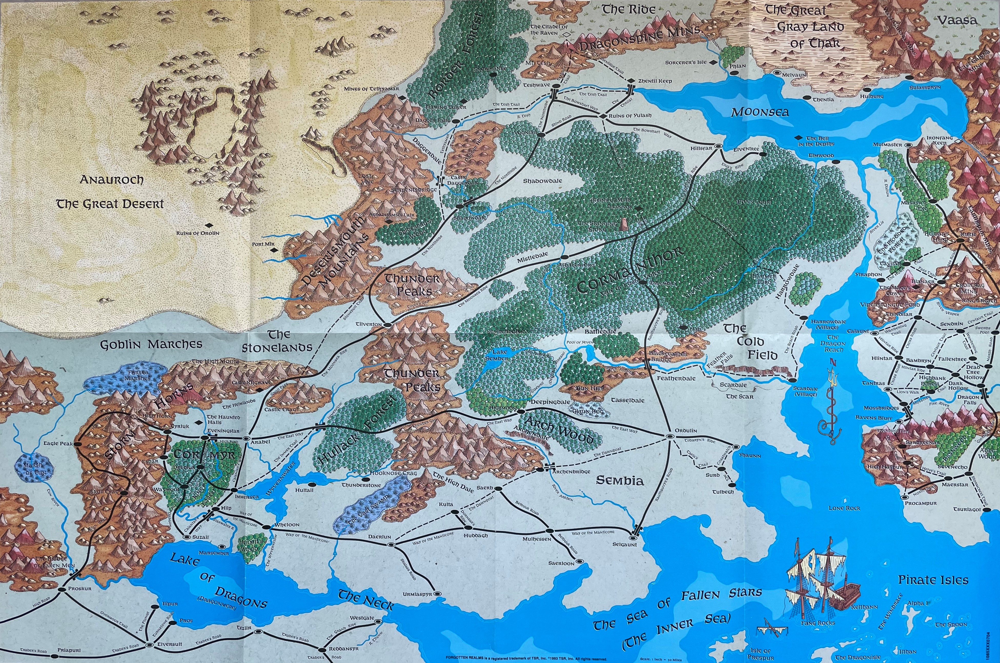
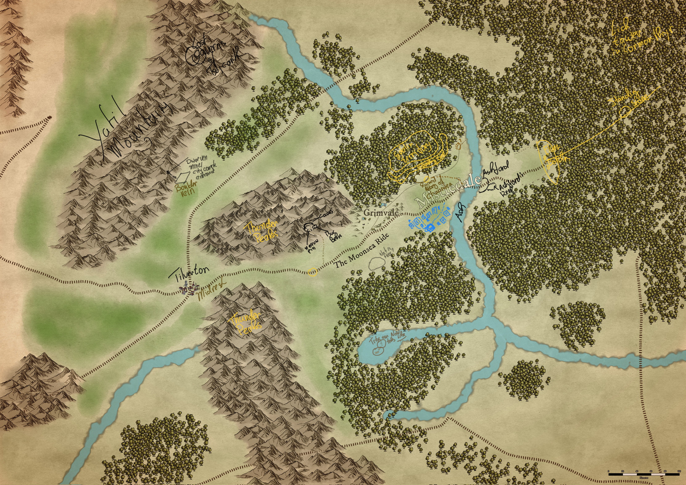
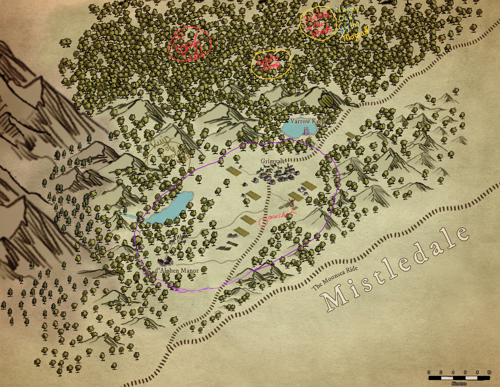
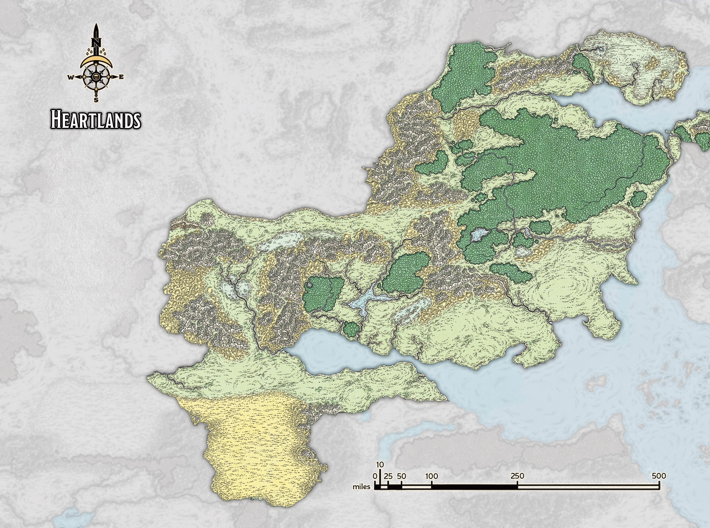
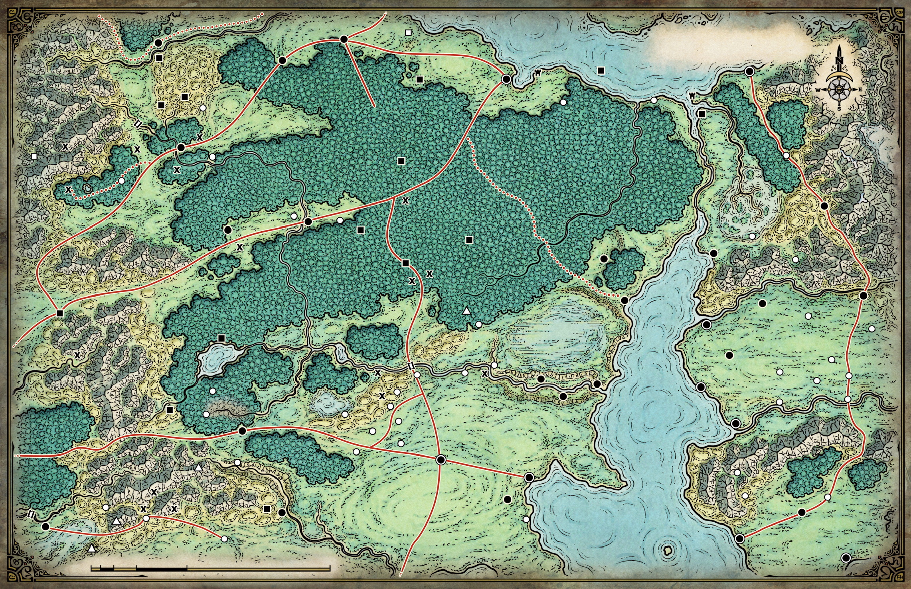
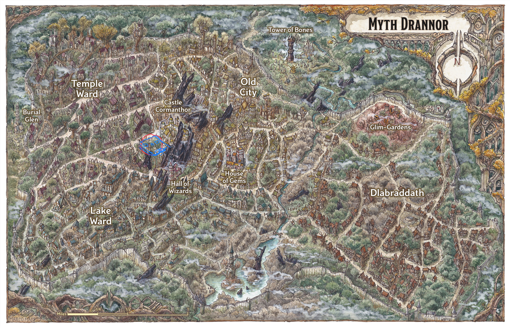

# ARKASTE - d’Alphen Burden of Blood  
[https://5e.tools/adventure.html#hotb](https://5e.tools/adventure.html#hotb)  
spell plague heeft zich niet voorgedaan.  
Houserules:  
bonus action to drink potion  
Powerstones!  
Mogelijkheid tot stap naar iets the upside down/, shadow realm, void realm  
Portal, later  
Psionic Spider - Caves of Chaos  
Harpers, Zentharim bestaan niet meer, andere organisaties.  
In de tussentijd Harpers en Zentharim doodgebloed.  
**Splort Tanglewib** - gnome  
**Book of Vile Deeds **(DMG 238)  
Book of Wicked Intent  
The Witchsmeller  
Into the Underdark in Cormanthyr  
Orc warbands - orcs moeten niets hebben van de cultist activiteiten, hebben een gespannen wapenstilstand.  
Tower of the Lich Empress?  
  
Moander God of Rot  
  
**FACTIONS**  
**Wildfangs**: Lycantropes, werewolves. Seth pack leader, Kassidy got killed by Eledra’s father when he was hunting. **Barlus Chortun** (Jager, vermist, Eledra heeft gevoelens voor) recentelijk aangesloten.  
‘The Crones of the Wood’: Esmee , Gytha, Margrath (Wyrd Sisters/The Fates) + Grebo (Tressym)  
Goblins, 2 tribes,** Rokghat (**steenvreters) tribe allied met de Cult of the Void, bij de caves of chaos, eerder gedwongen mee te werken, door Bugbear Stalkers (**Bugraghat**). **Ghughahat **(kikkerkoppen), chaotic neutral, village of the goblin chief, dieper in het bos.  
  
consequenties van acties,   
- goblins doden -> de rest van de goblin tribe zint op wraak  
- Klaus duwt, Gerda, persoonlijk consequenties -> Mark of the Doombringer  
- Aanwakkeren voidling, eerder dan gedacht aanwakkeren void invloeden. Cultus reageert actief.  
  

| LIKELIHOOD      | MOD | d20 RESULT + Modifier |           |
| --------------- | --- | --------------------- | --------- |
| Impossible      | -6  | 1                     | NO, AND!  |
| Highly Unlikely | -4  | 2-6                   | NO        |
| Unlikely        | -2  | 7-9                   | NO, BUT   |
| Possible        | 0   | 10-12                 | YES, BUT  |
| Likely          | +2  | 13-9                  | YES       |
| Highly Likely   | +4  | 20                    | YES, AND! |
| A Certainty     | +6  |                       |           |
  
  
  
[Dalelands](https://forgottenrealms.fandom.com/wiki/Dalelands)  
namegen: [https://www.fantasynamegenerators.com](https://www.fantasynamegenerators.com)  
mix met een cult of choas, crown of the kobold king, lost library of Letcounthos, Cormanthyr. Margreeve, labyrinth.  
[Moander](applenotes:note/0df41c2d-eefe-456e-b541-b1e8148361f8?ownerIdentifier=_b278a82f821370693820eb5509a1902d), God of Rot.   
**[Chantry of the Voidmother](https://koboldpress.com/maze-monday-gaze-not-long-into-the-great-chantry-of-the-voidmother/)**  
  
Clash elements  
Primordial  
Arcane  
Divine  
Wyrd  
Chaos  
Void  
  
Varesha is chaotisch neutraal  
**Cult of Chaos**, **Ilvis** is op zoek naar seeds of Chaos, of rifts of chaos, of willen deze creeeren. Basis in het bergachtige gebied achter Grimvale.   
**Aldous** (Mayor) is niet naar zijn zus, maar naar **Ilvis**, hij is een lid van de cult of the Void. Via Ilvis achter gekomen dat Varrow Keep een rift heeft en dat het pact er iets mee te maken heeft.   
Void interest into the rift. Divination laat een pilaar zien op astral niveau.  
Rift in Varrow Keep te gebruiken voor de [shadovar](https://forgottenrealms.fandom.com/wiki/Shadovar)  
Werkt met een dubbele agenda mee met de cult of chaos.  
  
De reden dat men [Selune](https://forgottenrealms.fandom.com/wiki/Sel%C3%BBne) aanbidt in Grimvale onbewust bescherming tegen [Shar](https://forgottenrealms.fandom.com/wiki/Shar).* The Mistress of the Night, the Dark Lady, Our Lady of Loss*  
The dark twin of Selûne, Shar is the goddess of darkness, both in its physical form and as it exists in the minds and souls of mortals.  
  
Mort Kemnon  
  
**Reputation**  
- Grimvale +1: names - [human](https://www.fantasynamegenerators.com/dnd-human-names.php)  
- Goblin clan -6: [names](https://www.fantasynamegenerators.com/dnd-goblin-names.php)  
- Barbarians of the World Tree  
- Cult of Chaos  
- Riders of Mistledale  
- [Tilverton](https://forgottenrealms.fandom.com/wiki/Tilverton)  
  
  
  
  
  
  
  
  
  
  
  
  
  
  
Luck point system ToV  
  
Nimble only attack role replacement with Damage Reduction AC-10  
Mana ipv spell slots: aantal spell slots + spell mod.  
level 1 is dat: 2 + 2 ‎ = 4.   
Spell level is cost, kan niet hoger casten dan caster level  
als geen mana roll to cast, roll over 20 - spell cast mod to cast  
  
Initiative: players just go, follow narrative, what is sensible. Behalve als surprised.  
Bij voorkeur. Defense roll. Bonus is AC-10, DM attack is 11+ to hit  
Bless + Bane static bonus, geldt voor elke d4 bonus, penalty max die value  
Death saves d20 + CON  
  
Amulet nodig  
  
Eledra d’Alphen  
Varrow Keep abandoned -> shade of Varesha, Spider metamorfoses, arises when the seal is broken  
Village - Skoward  
Goblin (just goblins at entrance)  
Cregdub  
  
**NPCs**  
Caramander & Estrella Varrow: phased out, between astral and materal plane.  
  
**LOCATIONS**  
**Grimvale**  
Inn, tavern: Olsen’s Cauldron  
Temple of Selune  
  
**Library of …**  
Scroll of Severing Ties… used to unlock amulet… ritual needs magic components  
- Holy water  
Guarded by the Spider Tyrant.  
  
**GRIMVALE **  
Beatrice Cole (35) looks 60, Olsen Cole (38) (Husband)  
*Occupation:* Innkeeper  
*Background:* Runs the local inn with a firm hand. Friendly, but nothing escapes her notice.  
Have run the inn for thirty years and look twenty years older than they should. Knows everything that happens in Grimvale and volunteers nothing. Will talk if the ale is flowing and the questions feel like conversation rather than investigation.  
  
Peter Ward  
*Occupation:* Night watchman  
*Background:* Patrols the streets after dark. Swears the town isn’t as quiet at night as people think.  
  
Gorrick Hardpelt(35): Temple, cleric, Selune  
Meridith**: **cleric, younger (25ish), worships Selune  
  
**Guards**: Thomas & Vannah (+2 others Peter Ward, not on duty).   
	Thomas heeft Albous’ assistent Narder ingelicht, in passing, dat er een groep nieuwkomers in het dorp was gekomen. Voor het dorp komt dat niet erg regelmatig voor. Narder Kettle is een beetje een sycophant en doet er alles aan om een wit voetje bij Albous te halen.  
**Edward Guttling: **Woodcutter, friend to Thomas (the miller), 35  
**Edward Bordard (18)**, farmhand, son of farmer, Johan (37) and Merryl (35). Edward is in love with Qild   
  
Session #0.5  
Session #1 Getting in, can we get out?  
  
# 2 Will they get out  
The party is still in the undergound chamber with two party members down, Mel and Klaus, but stable. The creature from the pit, the voidling, has retreated, but for how long? The party feels the urgency to get out as fast as possible. But how with the two party members down?  
  
- Hoar’s Reprimande; de god van Klaus bemoeit zich even met hem terwijl Klaus buiten bewustzijn is. Mark of the Doombringer will be cast.  
- Eledra is verdwenen, gevangen genomen door handlangers van Aldous. Alous wil cliamen dat Eledra de druk niet aankon en dat hij nu het rechtmatige hoofd van het huis is.  
- Goblins zinspelen op wraak.  
- Wat gaan ze met het boek doen? In bibliotheek,  geheime nis, in het dagboek bevindt zich nog een passage, ‘If holyness rains down on the locks, the shield may fail’   
- Maris’ bloed uit het amulet moet op de pagina van het pact , waar haar handtekening staat, in haar bloed, worden gedruppeld, terwijl pact break ritual moet worden gedaan. Vandaar dat het amulet en het boek beiden zijn afgeschermd, zodat het niet makkelijk te doen werd.  
  
Lycantropes, werewolves zijn pact aangegaan met Aldous. Hij heeft ze beloofd x.   
Aldous samen met wat andere samenzweerders willen de council omverwerpen in Mistledale. + Cult of Chaos  
  
Aldous has heared wispers in his mind and had dreams for months now, ‘release me’’, Aldous has known Eledra would try and lift the corruption. Yes it would lift the corruption, but it would also set free that would give him the power he deserves.   
  
Bij terugkomst buitenhuis, duidelijk dat Eledra ontvoerd is, sporen te vinden. Ook is te zien dat ze bezig was met onderzoek hoe de spreuk ongedaan te maken, om te keren. Terug te geven wat is ontnomen, er zijn aanwijzingen naar de bibliotheek van ….. Spelers kunnen kiezen, Eledra op sporen en bevrijden, zonder dat geen beloning. Of bibliotheek voor ongedaan maken spreuk. Dat zou later ook kunnen natuurlijk. Eledra is ontvoerd, omdat nogmaals doden te veel zou op vallen. Men heeft het doen lijken als dat ze gewoon is weggegaan, roddels verspreid dat ze de druk niet aan zou kunnen.  
  
Bibliotheek is in Cormanthyr, in de buurt van de Standing Stone.  
  
Goblin revenge! Goblins zijn in dit geval op zoek naar degenen die hun clansmates hebben vermoord.  
	They tried to, but unfortunatly with 7 goblins and their 		ogre buddy Gok, they failed, due to a smitething Klaus 		and Alora bouncing Chromatic Ball. 2 Goblins fled the 		scene after they’d seen Gok being cut in half.  
  
A local hunter named **Barlus Chortun** has gone missing, and Gorrick, the priest, asks the PCs to investigate and track the missing hunter down. Is nu een lycantroop. Connectie cult of Chaos?  
  
Ashabanford  
Council of Mystledale  
**Temple**: Curator **Fazzir**. Head priest **Ivlis** op langverwachte pelgrimage, maar ze is leider van de Cult of Chaos en de pelgrimage is een dekmantel voor haar activiteiten van de cult. Zijn op zoek naar seeds of chaos. Zou interesse hebben in rift in Varrow Keep, is een seed of chaos.   
  
[Lost Library of Lethchauntos](https://5e.tools/adventure.html#fraif-tllol)  
[https://www.mixedsignals.ml/games/blog/blog_review-lost-book-of-mektar](https://www.mixedsignals.ml/games/blog/blog_review-lost-book-of-mektar)  
  
Book of Mektar  
  
Red Gem - Message, tracking stone like thing?  
  
# 3   
Ruined temple to Chauntea, a bear is being attacked by blights. Party decides to help. Alora on horseback with Mel suprises the blight with an attack. A wild magic surge causes Alora to shed bright light, causing every creature in the area to be blinded. Blights have blindsight, so they are not affected. The bear turns out to be a druid (as Brunach suspected), **Eryndor Mossveil. **He tells them about blights attacking more and more (since 2 1/2 moon cycles). He is guarding well of rebirth. Connected to ley lines, life in the forrest, restores gently, not fast. Tells about Varrow’s part in the famine, their curiosity and quest for magical power in using the energy from the chaos, had uninteded consequences.They got more then they could contain. The druids have not been able to discern the way the rift works in drawing life energy from the people of Grimvale.  
  
# 4  
Taking en long rest in the cave beneath the temple to Chauntea, Mel wakes and asks Eryndor if he has got some incense. Eryndor has, but also offers Mel how to make it himself. After which Mel return to the rest of the party in the cave. Upon waking, the party hears hoofbeats and later people speaking in elfish to Erynor. Alora decides to take a peak. She wants to 	remain hidden, but unfortunately she is noticed by Eryndor and an unknown dwarf and elf. Eryndor tells the dward and elf that this is one oft adventurers that helped him with the wave of blights.  
  
—————  
$ Pre 5  
Bibliotheek Letchauntos in moeras in Cormanthyr, midden in moeras. De ingang van de blibliotheek lijkt vooral op een rots, met temple structuur. Een hydra zwemt daar rond, als bewaker ingang. De hydra wordt vereerd door de moerasgoblins (village of the goblin chief)  
