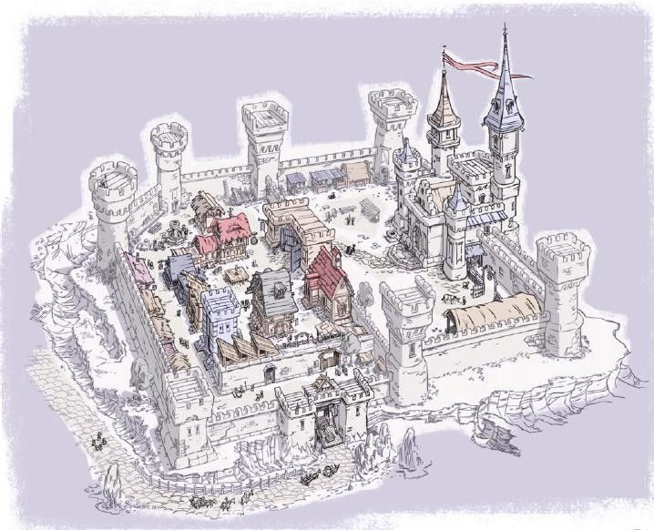
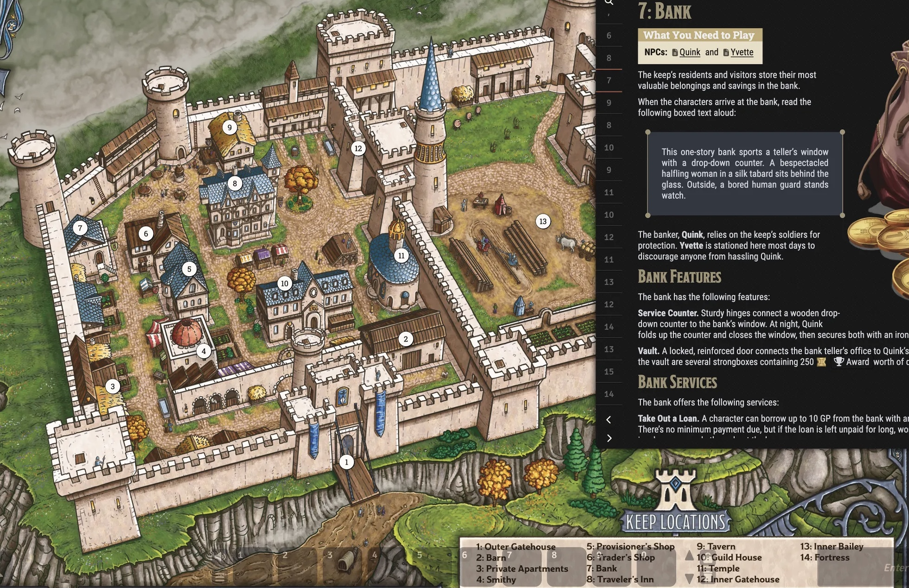

[Ashabenford](https://forgottenrealms.fandom.com/wiki/Ashabenford)  
Composed of rustic homes and collections of cottages, Ashabenford sat on the eastern side of the [River Ashaba](https://forgottenrealms.fandom.com/wiki/River_Ashaba), though some of its notable buildings were found also on the west bank. The busy trade route of the [Moonsea Ride](https://forgottenrealms.fandom.com/wiki/Moonsea_Ride) passed through the center of the small town,[5]and it served as a major stop between [Cormyr](https://forgottenrealms.fandom.com/wiki/Cormyr) and [Hillsfar](https://forgottenrealms.fandom.com/wiki/Hillsfar).[6]  
  
The [Council](https://forgottenrealms.fandom.com/wiki/Council_of_Six)’s members were elected representatives from around Mistledale who appointed the High Councilor of both Ashabenford and the dale. Once chosen, the High Councilor was expected to reside in Ashabenford all year round. The reigning High Councilor is [Haresk Malorn](https://forgottenrealms.fandom.com/wiki/Haresk_Malorn).  
  
### Riders of Mistledale  
  
  
## Ashabenford Keep   
(Keep on the Borderlands' keep)  
  
  
  
  
Keep Locations  
	1.	Outer Gatehouse  
	2.	Barn  
	3.	Private Apartments  
	4.	Smithy  
	5.	Provisioner’s Shop  
	6.	Trader’s Shop  
	7.	Bank  
	8.	Traveler’s Inn  
	9.	Tavern  
	10.	Guild House  
	11.	Temple  
	12.	Inner Gatehouse  
	13.	Inner Bailey  
	14.	Fortress  
  
|# |Naam                  |Leeftijd|Geslacht|Beroep                    |Relaties                 |Alignment|  
|--|----------------------|--------|--------|--------------------------|-------------------------|---------|  
|1 |Castellan             |~50     |M       |Heer van de Keep          |getrouwd met de Lady     |LG       |  
|2 |Lady of the Keep      |~45     |V       |Echtgenote van Castellan  |getrouwd met Castellan   |LG       |  
|3 |Bailiff               |~40     |M       |Beheerder/administrateur  |rapporteert aan Castellan|LG       |  
|4 |Captain of the Guard  |~35     |M       |Commandant garde          |onder Castellan          |LG       |  
|5 |Curate                |~40     |M       |Hoofdpriester (kapel)     |leidt acolieten          |LG       |  
|6 |Scribe                |~25     |M       |Klerk/secretaris          |werkt voor Castellan     |LN       |  
|7 |Banker                |onbekend|M       |Bankier                   |—                        |LN       |  
|8 |Trader                |onbekend|M       |Koopman                   |—                        |LN       |  
|9 |Provisioner           |onbekend|M       |Leverancier               |—                        |LN       |  
|10|Tavern Keeper         |onbekend|M       |Herbergier                |—                        |N        |  
|11|Jeweler (spion)       |onbekend|M       |Juwelier / verborgen spion|werkt voor Chaos         |CE       |  
|12|Evil Priest (vermommd)|onbekend|M       |Vermomd als pelgrim       |werkt voor Chaos         |CE       |  
  
  
  
  
[https://external-content.duckduckgo.com/iu/?u=https%3A%2F%2Fi.pinimg.com%2Foriginals%2F28%2F5d%2Fc0%2F285dc01ad70e9b2180354ab17870b6cf.jpg&f=1&nofb=1&ipt=c71d585971f012ad29e2090d7c7f3171859c4c7969da60908013b51ae6da6728](https://external-content.duckduckgo.com/iu/?u=https%3A%2F%2Fi.pinimg.com%2Foriginals%2F28%2F5d%2Fc0%2F285dc01ad70e9b2180354ab17870b6cf.jpg&f=1&nofb=1&ipt=c71d585971f012ad29e2090d7c7f3171859c4c7969da60908013b51ae6da6728)  
  
[https://r2.foundryvtt.com/website-uploads-public/screen/user_70/hotb-keep-2025-09-05.webp](https://r2.foundryvtt.com/website-uploads-public/screen/user_70/hotb-keep-2025-09-05.webp)  
  
  
[https://forum.rpg.net/index.php?threads/b-x-100-random-complications-for-the-keep-on-the-borderlands.594644/](https://forum.rpg.net/index.php?threads/b-x-100-random-complications-for-the-keep-on-the-borderlands.594644/)  
