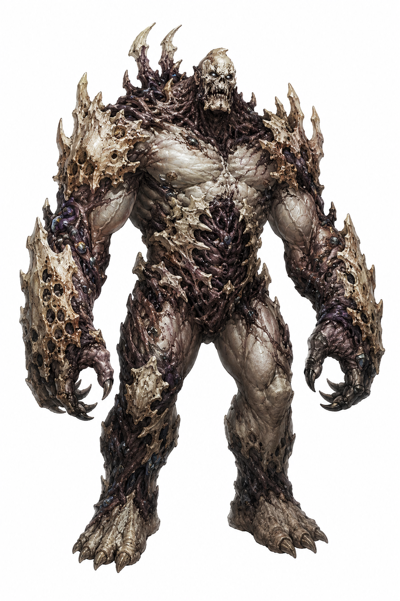

# Blights - Hits / Wounds  
## Twig Blight Small Plant, Neutral Evil  
Moander’s corruption (another cult)  
Init. +2 | AC 14 | HP 1 | Speed 20 |   
STR -2 | DEX +2 | CON +0 | INT -3 | WIS -1 | CHA -4  
Skills: Stealth +4  
Vuln: Fire  
Imm: Deafened  
Senses: Blindsight 60 ft., Passive Perception 9  
Languages: Understands Common but can't speak  
  
Pack Tactics: Advantage on attack rolls against a creature if at least one ally is within 5 ft. of it and isn't incapacitated.  
  
Claw: Melee +4, 5 ft. 1d4+2 Slashing.  
  
CR 1/8 (XP 25; PB +2)  
  
## Vine Blight Medium Plant, Neutral Evil  
Init. -1 | AC 12 | HP 2 | Speed 20 |  
STR +2 | DEX -1 | CON +2 | INT -3 | WIS +0 | CHA -4  
Skills: Stealth +1  
Imm: Deafened  
Senses: Blindsight 60 ft., Passive Perception 10  
Languages: Common  
  
Constricting Vine: Melee +4, 10 ft. 1d8+2 Bludgeoning. Large or smaller target Grappled (escape DC 12); while grappled, takes 1d8 Bludgeoning at start of each turn and the blight can't use this attack again.  
Entangling Plants (Recharge 5–6): Casts Entangle (CON, DC 12).  
  
CR 1/2 (XP 100; PB +2)  
  
## Needle Blight Medium Plant, Neutral Evil  
Init. +1 | AC 12 | HP 2 | Speed 30 |  
STR +1 | DEX +1 | CON +1 | INT -3 | WIS -1 | CHA -4  
Imm: Deafened  
Senses: Blindsight 60 ft., Passive Perception 9  
Languages: Understands Common but can't speak  
  
Claw: Melee +3, 5 ft. 2d4+1 Slashing.  
Needles: Ranged +3, 30/60 ft. 2d4+1 Piercing.  
  
CR 1/4 (XP 50; PB +2)  
  
## Twig Blight Small Plant, Neutral Evil  
Init. +2 | AC 14 | HP 1 | Speed 20 |  
STR -2 | DEX +2 | CON +0 | INT -3 | WIS -1 | CHA -4  
Skills: Stealth +4  
Vuln: Fire  
Imm: Deafened  
Senses: Blindsight 60 ft., Passive Perception 9  
Languages: Understands Common but can't speak  
  
Pack Tactics: Advantage on attack rolls against a creature if at least one ally is within 5 ft. of it and isn't incapacitated.  
  
Claw: Melee +4, 5 ft. 1d4+2 Slashing.  
  
CR 1/8 (XP 25; PB +2)  
  
## Blight Leaper Medium Undead, Chaotic Evil  
Init. +3 | AC 14 | HP 4 | Speed 30, Climb 20 |  
STR +2 | DEX +3 | CON +0 | INT -4 | WIS +1 | CHA -2  
Imm: Poison; Charmed, Exhaustion, Poisoned, Prone  
Senses: Darkvision 60 ft., Passive Perception 11  
  
Agile Pouncer: Moves min. 20 ft. straight toward target and hits with Claw or Tail Stab: +1d8 extra damage.  
Wall Climber: Can climb difficult surfaces, including upside down on ceilings, without an ability check.  
Sudden Retreat (Reaction): When taking damage, moves up to half speed without provoking opportunity attacks.  
  
Multiattack: Two attacks (any combination of Bite, Claw, or Tail Stab).  
Bite: Melee +5, 5 ft. 1d6+3 Piercing.  
Claw: Melee +5, 5 ft. 1d8+3 Slashing.  
Tail Stab: Melee +5, 5 ft. 1d10+3 Piercing.  
Leaping Strike (Recharge 5–6): Leaps up to 30 ft. toward a target, Tail Stab +7. On hit: +1d8 Piercing.  
  
CR 2 (XP 450; PB +2)  
  
## Blight Slasher Medium Undead, Chaotic Evil  
Init. +2 | AC 15 | HP 6 | Speed 30 |  
STR +3 | DEX +2 | CON +2 | INT -2 | WIS +0 | CHA -3  
Imm: Poison; Charmed, Exhaustion, Poisoned  
Senses: Darkvision 60 ft., Passive Perception 10  
  
Aggressive Charge: Uses action to charge, gaining +20 ft. speed this turn. If it reaches a target, Bladed Arm attack with advantage.  
Reactive Defense (Reaction): When taking damage, gains +2 AC until start of its next turn.  
Counter Slash (Reaction): When hit by a melee attack within 5 ft., makes one Bladed Arm attack against the attacker.  
  
Multiattack: Two Bladed Arm attacks. If both arms severed, can only Grapple or Bite.  
Bladed Arm: Melee +6, 5 ft. 2d6+3 Slashing.  
Grapple: Melee +6, 5 ft. Target Grappled (escape DC 13) and Restrained.  
Bite (only while grappling): Melee +6, 5 ft. 1d8+3 Piercing.  
  
CR 3 (XP 700; PB +2)  
  
## Tree Blight Huge Plant, Neutral Evil  
Init. +3 | AC 15 | HP 12 | Speed 30 |  
STR +6 | DEX +0 | CON +5 | INT -2 | WIS +0 | CHA -4  
Imm: Deafened  
Senses: Blindsight 60 ft., Passive Perception 10  
Languages: Understands Common and Druidic but can't speak  
  
Multiattack: Two Branch attacks and uses Grasping Root.  
Branch: Melee +9, 15 ft. 3d6+6 Bludgeoning.  
Grasping Root: DC 17 STR save, one Large or smaller creature within 15 ft. Fail: pulled up to 10 ft. toward the blight, Grappled (escape DC 16, one of six roots). While grappled, takes 2d6+6 Bludgeoning at start of each turn.  
Gnash (Bonus Action): DC 17 DEX save, one creature Grappled by the blight. Fail: 3d8+6 Piercing. Success: half damage.  
  
CR 7 (XP 2.900; PB +3)  
  
(dit zijn getransmuteerde overvallen, humanoids)  
  
## Blight Brute Large Undead, Chaotic Evil  
Init. +0 | AC 16 | HP 102 | Speed 30 |  
STR +5 | DEX +0 | CON +3 | INT -3 | WIS +0 | CHA -2  
Save: STR +8, CON +6  
Res: Bludgeoning, Piercing, Slashing (nonmagical)  
Imm: Poison; Charmed, Exhaustion, Poisoned  
Senses: Darkvision 60 ft., Passive Perception 10  
  
Aggressive Regeneration: Any single attack dealing 15 or less damage after resistances is negated.  
Bulwark of Bone: A limb requires three critical hits to sever.  
  
Multiattack: Two Slam attacks.  
Slam: Melee +9, 10 ft. 3d8+5 Bludgeoning. DC 17 STR save or Prone.  
Charge: Moves min. 20 ft. straight toward target and hits with Slam: +2d8 Bludgeoning, DC 17 STR save or pushed 10 ft. and Prone.  
Explosive Counter (Recharge 5–6): Each creature within 10 ft. makes DC 15 DEX save or takes 4d10 Piercing; half on success.  
  
CR 8 (XP 3.900; PB +3)  
  
  
  
  

| Name              | Type     | Source                              |
| ----------------- | -------- | ----------------------------------- |
| Blight Brute      | creature | Xenobestiary                        |
| Blight Crawler    | creature | Xenobestiary                        |
| Blight Flier      | creature | Xenobestiary                        |
| Blight Fodder     | creature | Xenobestiary                        |
| Blight Leaper     | creature | Xenobestiary                        |
| Blight Monarch    | creature | Xenobestiary                        |
| Blight Pack Spawn | creature | Xenobestiary                        |
| Blight Slasher    | creature | Dias Ex Machina Games, Xenobestiary |
| Blight Spitter    | creature | Xenobestiary                        |
| Blight Stalker    | creature | Xenobestiary                        |
| Blight Swarmer    | creature | Xenobestiary                        |
| Blight Twitcher   | creature | Xenobestiary                        |
| Blight Urmorph    | creature | Xenobestiary                        |
  
  
  
