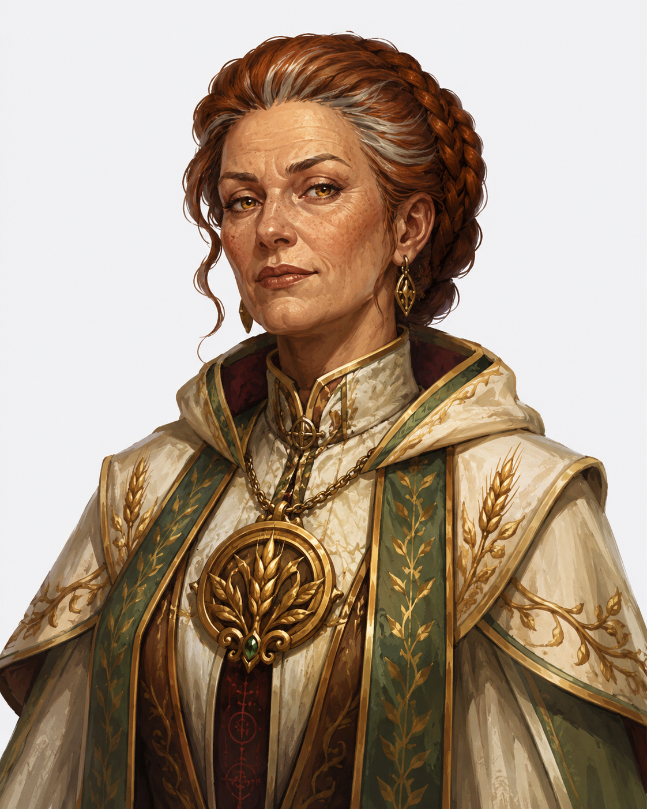
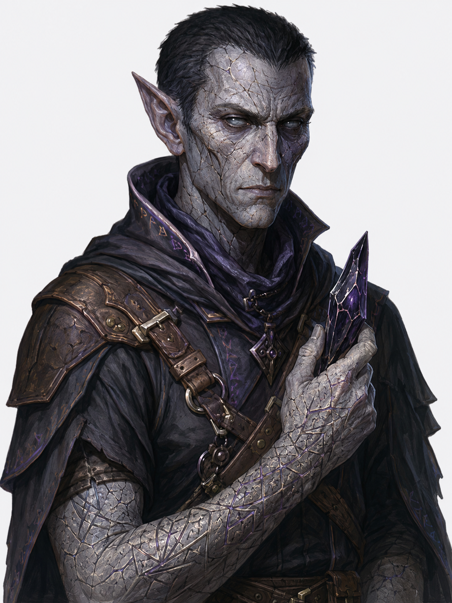
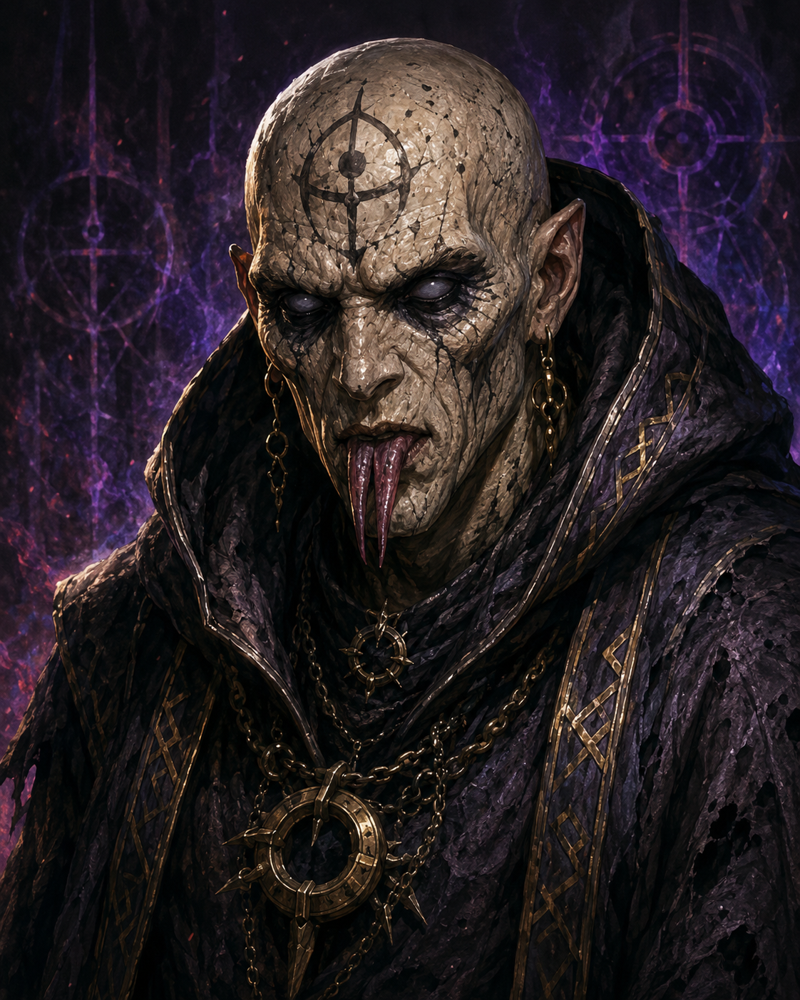

# Cult of Chaos  
**Ivlis Marrowen** is a 47 year old female human Priestess.  
She has grey-streaked auburn hair worn in a tight devotional braid and pale amber eyes.  
She has weathered, sun-spotted skin.  
She stands 168 cm (5’6”) tall and has a slender, upright build.  
She has a serene, matronly face.  
  
She still wears her temple’s holy symbol openly in Ashford, though it now serves only as a mask for the rune she carved beneath it, hidden under her vestments.  
  
  
  
Personality Traits  
She outwardly worships Chauntea, Goddess of Agriculture, but in secret has forsaken that oath in service to the Chaos Void. (Chaotic Evil)  
She weighs every decision against how it serves the cult’s long game, never acting on impulse.  
She is meticulous in maintaining her pious reputation to a fault, rehearsing sermons she no longer believes in. She insists on tending the temple gardens herself, a habit parishioners read as humility rather than a cover for nightly absences.  
  
Ability Scores  
Strength - 9 (-1)	Dexterity - 12 (+1)	Constitution - 13 (+1)  
Intellect - 14 (+2)	Wisdom - 16 (+3)	Charisma - 17 (+3)  
  
Relationships  
Sexual Orientation - Straight  
Relationship Status - Widowed; her late husband’s death is what she tells parishioners drove her devotion deeper, though it in truth marked her turn toward the cult.  
  
Alignment Tendencies  
Good: 1		Lawful: 2  
Neutral: 3	  Neutral: 3  
Evil: 6		Chaotic: 5  
  
Plot Hook  
Ilvis announced a long-awaited pilgrimage to cover her absence, she has been overseeing the Mistledale cell from within the Caves of Chaos, and her return sermon is timed to coincide with whatever Dravik Sorn’s rift-hunting unearths.  
  
**Dravik Sorn** is a 154 year old male Shadar-kai Scout.  
He has black, brittle hair cropped close to the scalp and flat charcoal-grey eyes with no visible pupil.  
He has ashen-grey skin, cracked and dry like sun-baked clay.  
He stands 165 cm (5’5”) tall and has a lean, wiry build.  
He has a gaunt, angular face.  
  
Each time he survives a tear in reality, he carves a fresh rift-rune into his forearm with a shard of void-glass, leaving his arms a dense lattice of scar tissue.  
  
  
  
Personality Traits  
He does not worship a true deity; he reveres the Chaos Void itself as the font of all inevitable change.  
He lets chance dictate his choices, often flipping a shard of void-glass before acting in moments of doubt.  
He is fervently devoted to the cult’s creed to a fault, treating every collapsing rift as a kind of holy omen. He hums fragments of an old elvish lullaby, tunelessly, while lying in ambush.  
  
Ability Scores  
Strength - 12 (+1)	Dexterity - 16 (+3)	Constitution - 13 (+1)  
Intellect - 10 (+0)	Wisdom - 12 (+1)	Charisma - 13 (+1)  
  
Relationships  
Sexual Orientation - Straight  
Relationship Status - Unattached; severed ties with his former shadar-kai enclave upon joining the cult.  
  
Alignment Tendencies  
Good: 1		Lawful: 1  
Neutral: 4	Neutral: 3  
Evil: 5		Chaotic: 6  
  
Plot Hook  
Dravik has been marking territory near the same rift site the party’s secretive mage has been investigating, suggesting the Cult of Chaos and the Embers of Enlightenment are racing for control of the same tear in reality.  
  
**Urkin Vass** is a 38 year old male human Cult Fanatic.  
He has no hair, his scalp fused smooth from repeated exposure to the Void, and deep-set, hollow black eyes with no visible white.  
He has grey, cracked skin that flakes like dried mud when he moves.  
He stands 178 cm (5’10”) tall and has a gaunt, stooped build.  
He has a sunken, hollow-cheeked face.  
  
His tongue is split down the middle, and he hisses faint fragments of the rift-tongue between words, as though two voices are speaking through him at once.  
  
  
Personality Traits  
He does not worship a true deity; he has given himself wholly to the Chaos Void as a vessel for its will. (Chaotic Evil)  
He acts on whatever impulse the Void seems to whisper to him in the moment, rarely deliberating.  
He is unsettlingly calm in the face of violence to a fault, treating bloodshed as a ritual offering rather than a means to an end. He keeps his hood drawn low at all times, even indoors, and grows visibly agitated if forced to remove it.  
  
Ability Scores  
Strength - 11 (+0)	Dexterity - 13 (+1)	Constitution - 12 (+1)  
Intellect - 9 (-1)	Wisdom - 14 (+2)	Charisma - 15 (+2)  
  
Relationships  
Sexual Orientation - Straight  
Relationship Status - Unattached; the Void is described, by him, as his only true bond.  
  
Alignment Tendencies  
Good: 0		Lawful: 1  
Neutral: 2	Neutral: 2  
Evil: 8		Chaotic: 7  
  
Plot Hook  
Urkin has been seen slipping in and out of the Caves of Chaos at odd hours, ferrying coded messages between Ilvis Marrowen and Dravik Sorn’s rift-hunting unit.  
  
