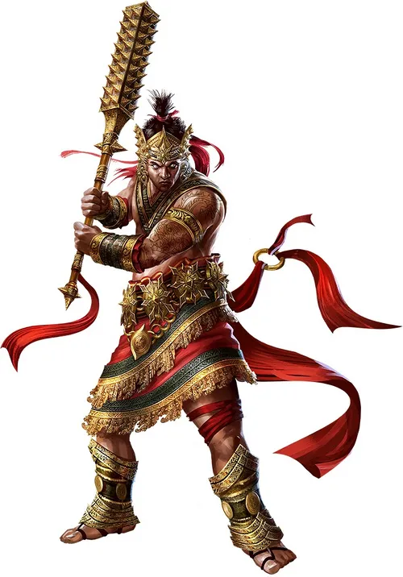
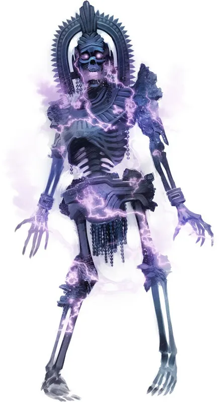

## Danava Titan Gargantuan Humanoid (Titan), Lawful Neutral  
  
Init. +8 | AC 22 | HP 305 | Hits 31 | Speed 50, Fly 50, Swim 40 |  
STR +11 | DEX +8 | CON +10 | INT +10 | WIS +8 | CHA +6  
Save: +4 bonus vs. Mental and Divine effects  
Skills: Acrobatics +14, Arcana +16, Athletics +18, Crafting +16, Nature +14, Occultism +16, Religion +14, Society +16  
Imm: Death effects, Disease  
Senses: Darkvision, Truesight 120 ft., Wavesense 100 ft., Passive Perception 18  
Languages: Chthonian, Common, Empyrean, Thalassic; Telepathy 100 ft.  
  
Impossible Stature (Aura, 100 ft.): Creatures entering or starting turn in range make DC 22 WIS save or movement toward the titan costs double movement (critical fail: triple). Lasts 1 round.  
Hadalic Presence: Creatures that fail the Impossible Stature save also experience crushing ocean depths — they are Blinded (as magical darkness) and the titan can detect them as a precise sense regardless of distance. Critical fail: also Restrained.  
Relentless: Permanently gains one extra action per turn, usable only to move, Strike, Sustain a Spell, or as part of casting dispel magic.  
Water Walk: Permanently walks on water.  
  
Multiattack: Two Greatclub attacks, or one Greatclub and one Foot attack.  
Greatclub: Melee +18, 40 ft. 4d10+20 Bludgeoning + 2d12 Cold. Can shove on hit.  
Foot: Melee +18, 30 ft. 4d8+20 Bludgeoning + 2d12 Cold.  
Benthic Wave: Ranged +18, 200 ft. 4d6+20 Bludgeoning + 2d12 Cold.  
Spellcasting: WIS (DC 22, +14). At will: control water, dispel magic, hydraulic push, hydraulic torrent. 3/day each: eclipse burst, heal, hydraulic torrent. 1/day: implosion.  
Trample (3 actions): Moves up to speed; each Huge or smaller creature in path makes DC 22 STR save or takes Foot damage and is Prone.  
Wide Cleave (2 actions): Greatclub attack against every creature within reach. Counts as three attacks for action economy.  
Roiling Rebuke (Reaction): Trigger: A creature within 200 ft. targets the titan with an attack, spell, or effect. Effect: One Benthic Wave attack against the triggering creature; on hit, the triggering action is disrupted.  
  
CR 21 (XP 33.000; PB +7)  
  
Control Water: Raise or lower water level in 100-ft. area by up to 20 ft., or part water to create a 20-ft.-wide trench. Concentration, 10 minutes.  
Dispel Magic: End one spell of 9th level or lower; higher levels require DC 10 + spell level check.  
Hydraulic Push: One creature within 60 ft., DC 22 STR save or pushed 30 ft. and Prone.  
Hydraulic Torrent: 60-ft. line, DC 22 STR save or pushed 30 ft. and Prone; half distance on success.  
Eclipse Burst: 60-ft. radius within 500 ft. All creatures make DC 22 CON save: fail 10d10 Cold + Blinded 1 minute; success half, not blinded.  
Heal (9th): One creature regains 7d8+40 HP, or burst heals all allies within 30 ft.  
Implosion (10th): One creature within 30 ft. per turn. DC 22 CON save or takes 180 Force damage; half on success. Concentration, 1 minute. Constructs and objects automatically fail.  
  
  
## Tzitzimitl Gargantuan Undead, Chaotic Evil  
  
Init. +8 | AC 19 | HP 253 | Hits 26 | Speed 50, Fly 60 |  
STR +10 | DEX +8 | CON +6 | INT +5 | WIS +7 | CHA +8  
Res: Cold 15, Bludgeoning bypasses; all other physical 15  
Vuln: Radiant 15  
Imm: Bleed, Disease, Lightning, Paralyzed, Poison, Unconscious; Death effects  
Senses: Darkvision, Truesight 60 ft., Passive Perception 22  
Languages: Aklo, Chthonian, Common, Empyrean  
  
Fast Healing 15: Regains 15 HP at start of each turn.  
Drain Life: Claw damage vs. living creature grants tzitzimitl 20 temporary HP. Target makes DC 21 CON save or gains Drained 2 (fail increases by 2 on subsequent hits, max Drained 4).  
Light to Dark (Reaction): Trigger: A creature within 120 ft. uses a healing ability or spell. Effect: The ability loses the healing property and instead deals Necrotic damage equal to its healing value.  
  
Multiattack: Two Claw attacks, or one Claw and one Eye Beam.  
Claw: Melee +14, 20 ft. 4d12+10 Slashing + 3d8 Lightning + Drain Life.  
Eye Beam: Ranged +14, 100 ft. 4d12 Lightning + 10d6 Force.  
Spellcasting: WIS (DC 21). At will: detect magic. 3/day each: darkness (9th), haste, teleport. 3/day: eclipse burst, teleport (long range). 1/day each: wails of the damned.  
Eclipse (2 actions): Casts darkness in 20-ft. burst; all creatures in area make DC 21 CON save:  
  Success: 4d8 Cold.  
  Fail: 8d8 Cold, Slowed 1 (speed halved) 1 minute.  
  Critical Fail: 16d8 Cold, Slowed 2, 1 minute, and Doomed 1.  
  
CR 17 (XP 18.000; PB +6)  
  
Darkness (9th): 120 ft., 20-ft. burst. Magical darkness suppressing light of 4th level or lower; even darkvision treats targets as lightly obscured. 1 minute.  
Haste (7th): Up to 6 creatures within 30 ft. gain one extra action per turn (Strike or Stride only). Concentration, 1 minute.  
Teleport (7th): You and up to 4 willing creatures teleport up to 1,000 miles to a known location. 10-minute cast.  
Eclipse Burst (7th): 500 ft., 60-ft. burst. DC 21 DEX save: fail 8d10 Cold + 8d4 Necrotic (living only); success half; critical fail double + Blinded (unlimited). Counteracts magical light in area.  
Wails of the Damned (9th): 40-ft. burst. All living enemies make DC 21 CON save or take 8d10 Necrotic. Fail: +1d4 Drained. Critical fail: double damage + Drained 4.  
Detect Magic: 30-ft. pulse detecting presence of magic. Cantrip.  
  
