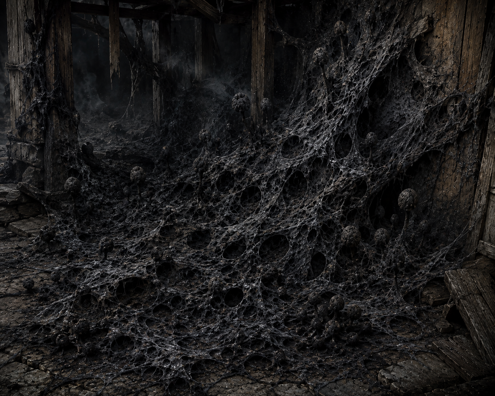

## Enfeebled condition  
stats -1  
##   
## Ash Web Hazard   
Environmental Fungus (Hazard)  
Stealth DC 18 (Passive Perception) | AC 18 | HP 100 |  
Imm: Acid, Fire, Lightning, Poison, Critical Hits, Precision Damage  
  
Description: Sooty black mold covering up to nine 10-ft. squares; treated as a single organism. Dies when HP reaches 0. Only cold damage harms it without triggering spores. Cannot trigger in direct sunlight.  
  
Detect: DC 18 Perception to notice before disturbing.  
Disable: DC 15 Survival to safely remove one 10-ft. patch without triggering spores.  
  
**Spore Explosion (Reaction)**: Trigger: A creature enters the ash web's space or deals non-cold damage to it. Effect: The triggering creature and all creatures within 10 ft. must make a DC 16 CON save or be exposed to Ash Web Spores.  
  
**Ash Web Spores (Inhaled Poison)**: DC 16 CON save at the end of each turn for 6 rounds.  
  Stage 1: 2d6 Poison + Poisoned (Enfeebled 1: -1 to STR checks and saves).  
  Stage 2: 4d6 Poison + Enfeebled 2 (-2 to STR checks and saves).  
  Stage 3: 6d6 Poison + Enfeebled 3 (-3 to STR checks and saves).  
Enfeebled condition persists after poison ends; reduces by 1 per hour.  
Gugs (if present) are immune; experience vivid dreams instead.  
  
Reset: Resets at the start of each round.  
  
  
## Grothlut Medium   
Aberration, Neutral  
Init. -2 | AC 15 | HP 33 | Speed 20 |  
STR +4 | DEX -2 | CON +4 | INT -5 | WIS +0 | CHA -3  
Imm: Acid, Mental (Charmed, Frightened)  
Senses: Darkvision 60 ft., Passive Perception 10  
  
**Disgusting Demise**: When reduced to 0 HP, digestive organs rupture. All creatures within 30 ft. make DC 13 CON save or take 2d6 Acid and Poisoned until end of next turn. Fail by 5+: double damage and Poisoned for 1 minute.  
**Piteous Moan (Aura, 60 ft.)**: Each non-grothlut creature that enters or starts its turn in range makes DC 13 WIS save or Sickened 1 (fail by 5+: Sickened 2). On success, immune for 1 minute. Grothlut can activate/deactivate as a free action.  
  
**Claw**: Melee +5, 5 ft. 1d10+4 Slashing.  
**Digestive Spew**: Ranged +3, 15 ft. 2d6 Acid + 1d6 Acid splash to all creatures within 5 ft. of target.  
  
CR 2 (XP 450; PB +2)  
  
  
## Myth Drannor Poltergeist   
Medium Undead (Incorporeal Spirit), Lawful Evil  
Init. +5 | AC 17 | HP 117 | Speed Fly 30 (hover) |  
STR -5 | DEX +5 | CON +2 | INT -1 | WIS +4 | CHA +5  
Save: DEX +9, WIS +8  
Skills: Acrobatics +11, Intimidation +9, Stealth +11  
**Res**: All nonmagical damage; Force and magical attacks bypass resistance  
**Imm**: Disease, Paralyzed, Poison, Prone, Unconscious; Precision damage  
**Senses**: Darkvision 120 ft., Passive Perception 14  
**Languages**: Dwarven, Elven  
  
**Site Bound**: Cannot travel more than 120 ft. from its bound location.  
**Natural Invisibility**: Permanently invisible unless using Frighten. Becomes visible at start of Frighten; turns invisible again at start of its next turn.  
**Rejuvenation**: When destroyed, reforms fully healed after 2d4 days. Permanent death only if the Mythal no longer exists over Myth Drannor.  
  
**Multiattack**: Two Telekinetic Object attacks.  
**Telekinetic Object**: Ranged +6, 60 ft. 4d6 Bludgeoning, Piercing, or Slashing (depending on object).  
**Spellcasting**: WIS (DC 16, +6). At will: telekinetic haul, telekinetic maneuver, mage hand.  
**Frighten (Requires invisible)**: Poltergeist becomes visible as a skeletal ghostlike humanoid. All creatures within 30 ft. make DC 16 WIS save or Frightened 2 turns (on critical fail, must also Dash away while frightened). On success, immune for 24 hours.  
**Telekinetic Storm**: Choose one mode:  
  Spread: Telekinetic Object attack at −2 against each creature within 30 ft. (all count as one action).  
  Focused: Single target, 6d6 damage; DC 16 STR save for half, no damage on critical success.  
**Telekinetic Defense (Reaction)**: Trigger: A creature approaches within 10 ft. Effect: One Telekinetic Object attack against the triggering creature.  
  
CR 10 (XP 5.900; PB +4)  
  
**Mage Hand**: Move an object up to 10 lb. within 30 ft. Cantrip.  
**Telekinetic Haul**: Move a Large or smaller object up to 20 ft. in any direction. At will.  
**Telekinetic Maneuver**: Shove or Disarm attempt against a creature within 60 ft., WIS +7. At will.  
  
## Snapping Flytrap Large Plant, Neutral  
Init. +3 | AC 15 | HP 33 | Speed 15 |  
STR +2 | DEX +3 | CON +5 | INT -5 | WIS +2 | CHA -2  
Skills: Athletics +5, Stealth +7 (+10 in undergrowth)  
Vuln: Fire  
Res: Acid  
Imm: Mental (Charmed, Frightened)  
Senses: Tremorsense 30 ft., Passive Perception 12  
  
Quick Capture (Reaction): Trigger: A creature hits or touches the flytrap. Effect: Leaf attack against the triggering creature; on hit, target is Grappled.  
  
Multiattack: Two Leaf attacks, each against a different target.  
Leaf: Melee +5, 10 ft. 1d8+2 Piercing + 1d6 Acid. On hit, target Grappled (escape DC 13).  
Focused Assault: Single target; one Leaf attack. On hit: 1d8+2 Piercing + 1d6 Acid + 1d8 bonus damage. On miss: 1d8+2 Piercing only, no Grapple. No damage on critical miss.  
Swallow Whole: One Medium or smaller Grappled creature; 1d8+1 Bludgeoning + 1d6 Acid. Target Swallowed; escapes by dealing 5 damage to the flytrap's interior (AC 10).  
  
CR 2 (XP 450; PB +2)  
