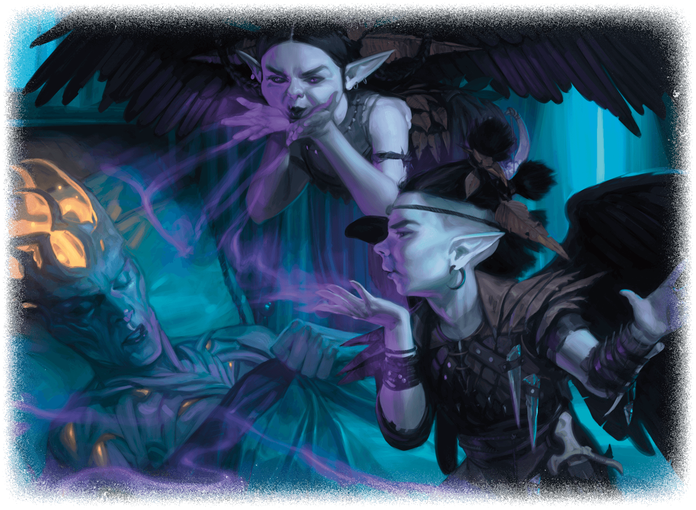

## Faerie Pest Small Fey, Typically Chaotic Evil  
Faerie pests love to cause annoyance, fear, and pain. They are perhaps the most mercurial of the faeries and are happy to follow anyone who promises the opportunity to menace someone new.  
A faerie pest could be mistaken for a human toddler except for the black-feathered wings sprouting from the faerie’s shoulders. When engaged in combat, faerie pests wield thought-manipulating magic alongside sharp blades coated in stinging poison.  
  
Init. +3 | AC 14 (leather armor) | HP 22 | Hits 3 | Speed 30, Fly 30 |  
STR -1 | DEX +3 | CON +1 | INT +0 | WIS +1 | CHA +2  
Skills: Perception +3, Stealth +7  
Senses: Darkvision 60 ft., Passive Perception 13  
Languages: Common, Sylvan  
  
Stingblade: Melee +5, 5 ft. 1d6+3 Slashing + 2d4 Poison. If attack had advantage: +1d6 Slashing.  
Spellcasting: CHA (DC 12). 2/day each: bane, grease. 1/day: blindness/deafness.  
Theft of Nerves (1/day): 15-ft. cone, DC 12 INT save or Frightened 1 minute. Repeat save at end of each turn.  
Mischievous Stealth (Bonus Action): Takes the Hide action.  
  
CR 1 (XP 200; PB +2)  
  
Bane: Up to 3 creatures within 30 ft., DC 12 CHA save or −1d4 to attack rolls and saves. Concentration, 1 minute.  
Grease: 10-ft. square within 60 ft., DC 12 DEX save or Prone. Greased area is difficult terrain. Concentration, 1 minute.  
Blindness/Deafness: One creature within 30 ft., DC 12 CON save or Blinded or Deafened. 1 minute.  
