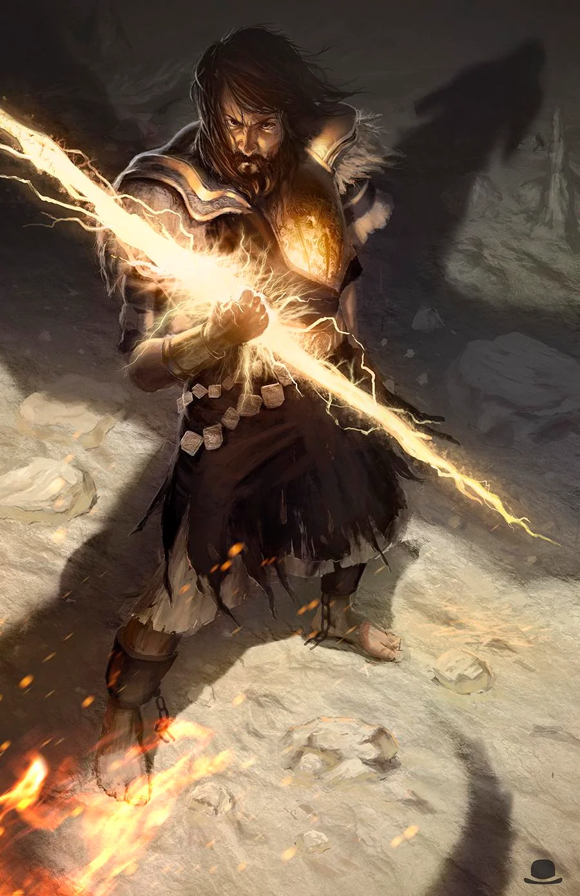

# Hoar’s Reprimande  
[https://forgottenrealms.fandom.com/wiki/Hoar](https://forgottenrealms.fandom.com/wiki/Hoar)  
  
  
While down and unconscious Klaus begins to sees the Image of Hoar. Hoar is displeased because in his view he has, maybe, purportraited an evil and or cowardly act; to push Gerda into the kitchen knowing they she might sustain necrotic damage, while not stepping in himself.  
  
Klaus in an empty hall, but surrounded by clear emptiness, a human walks up to him, recognizable as Hoar.  
  
*“My paladins are expected to deliver justice, not arbitrarily put allies in harm’s way.”*  
  
	•	A warning with a temporary mechanical consequence (disadvantage on certain checks until he atones)  
	•	A threat of [Oathbreaker](https://forgottenrealms.fandom.com/wiki/Oathbreaker) status if this pattern continues  
	•	An imposed atonement — such as explicitly protecting Gerda or asking her forgiveness  
  
Mark of the Doombringer  
