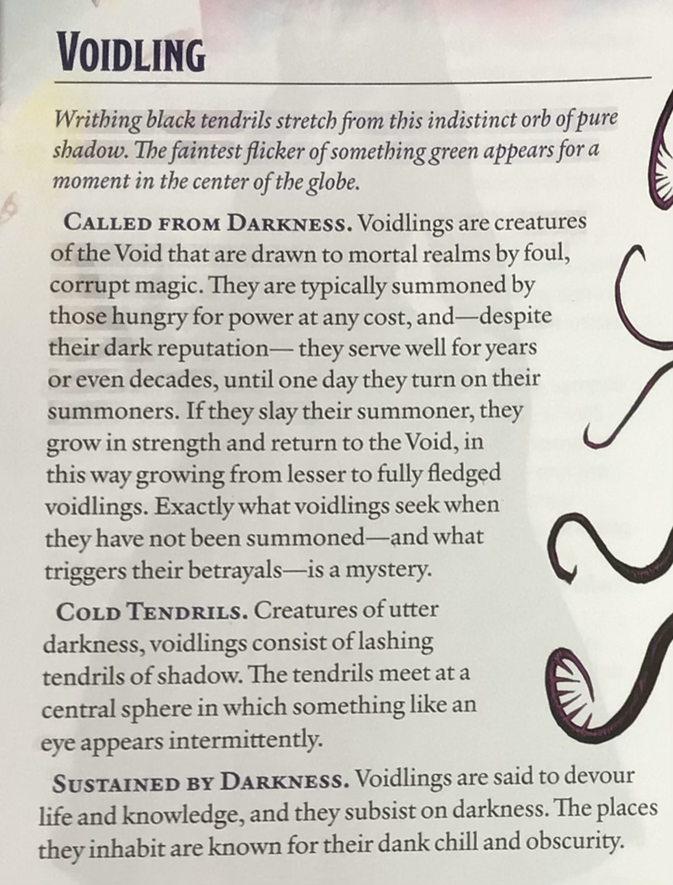

# Lesser Voidling Small Aberration, Unaligned  
Init. +3 | AC 13 | HP 93 | Speed 0, Fly 30 (hover) |  
STR +0 | DEX +3 | CON +2 | INT +3 | WIS +3 | CHA +0  
Skills: Perception +15, Stealth +16  
Res: Aberrant Resilience (Charmed, Frightened, Paralyzed, Stunned; voordeel op saves vs. vormaanpassing)  
Imm: Necrotic; Exhaustion, Petrified, Prone  
Senses: Truesight 60 ft.  
Languages: Void Speech, Telepathy 60 ft.  
  
Darkness Regeneration: In dim light of duisternis herstelt 2 HP aan begin van beurt (min. 1 HP).  
Magic Resistance: Voordeel op saves tegen spreuken en magische effecten.  
Void Dweller: Heeft geen lucht, voedsel, drank, slaap of druk nodig; immuun voor Void-terreineffecten; kan door de Void vliegen als door lucht.  
  
Multiattack: Drie Shadow Tendril- of Necrotic Bolt-aanvallen.  
**Shadow Tendril**: Melee +5, 5 ft. 1d4+3 Bludgeoning + 2d8 Necrotic.  
**Necrotic Bolt**: Ranged +5, 120 ft. 2d6+3 Necrotic.  
**Necrotic Burst** (Recharge 5–6): Elk wezen binnen 10 ft. maakt DC 13 WIS save of neemt 6d6 Necrotic; halve schade bij succes.  
  
CR 4  
  
  
  
  
