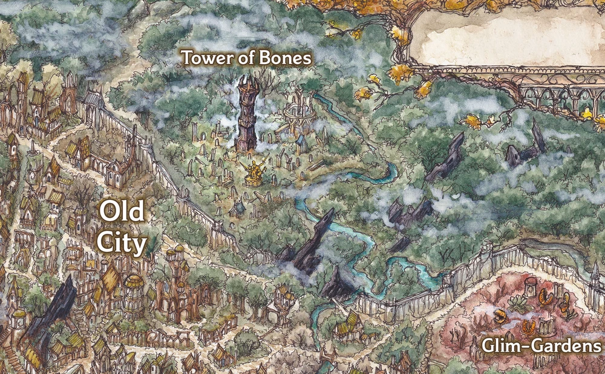

# Letchauntos crypt/library/workshop  
  
[Myth Drannor Settlement in Faerun | World Anvil](https://www.worldanvil.com/w/faerun-cos-the-wanderer/a/myth-drannor-settlement)  
  
  
  
  
## group dice roll  
dc 13 wisdom recht voor mausoleum, anders Bonegrinder arena  
##   
## One shot zombies, minions  
Of Zombie Swarm, Crit takes out 2  
  
## Candlecorpse Medium Undead, Neutral Evil  
Init. +1 | AC 14 (natural armor) | HP 73 | Hits 8 | Speed 30 |  
STR +3 | DEX +1 | CON +3 | INT -2 | WIS -1 | CHA -1  
Res: Fire, Piercing  
Imm: Poison; Exhaustion, Poisoned (Undead Resilience)  
Senses: Darkvision 60 ft., Passive Perception 11  
Languages: Understands languages it knew in life but can't speak  
  
False Appearance: While motionless and prone, indistinguishable from a wax-covered humanoid skeleton.  
Hot Wax: Creatures touching or hitting it with a melee attack within 5 ft. take 1d4 Fire.  
Illumination: Sheds bright light 30 ft., dim light an additional 30 ft.  
Undead Nature: Doesn't require air, food, drink, or sleep.  
  
Multiattack: Two Battleaxe attacks.  
Battleaxe: Melee +5, 5 ft. 1d8+3 Slashing (1d10+3 two-handed) + 1d8 Fire.  
Flame Wave (Recharge 5–6): 15-ft. cone, DC 14 DEX save or 4d8 Fire; half on success.  
Burning Wax (Bonus Action): One creature within 30 ft., DC 14 DEX save or Restrained by wax. While restrained: 1d4 Fire at start of each turn. Ends after 1 minute or on cold damage. DC 14 STR check (advantage if target took cold damage) to free.  
  
CR 3 (XP 700; PB +2)  
  
or  
Crypt 3x5  
  
  
  
  
  
  
  
