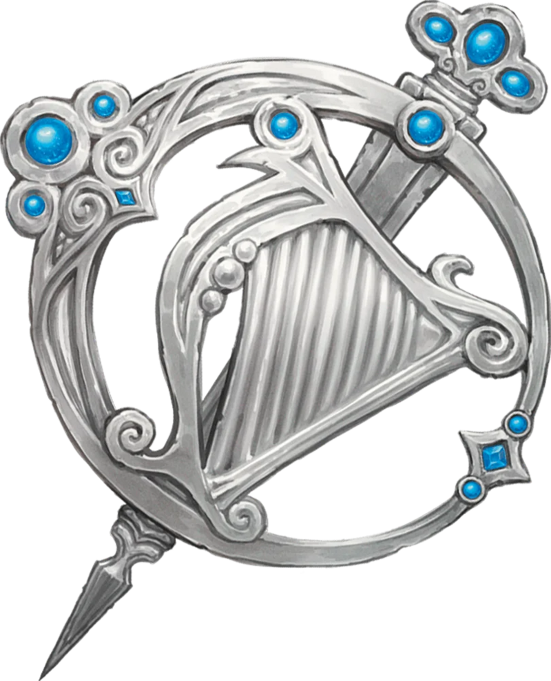
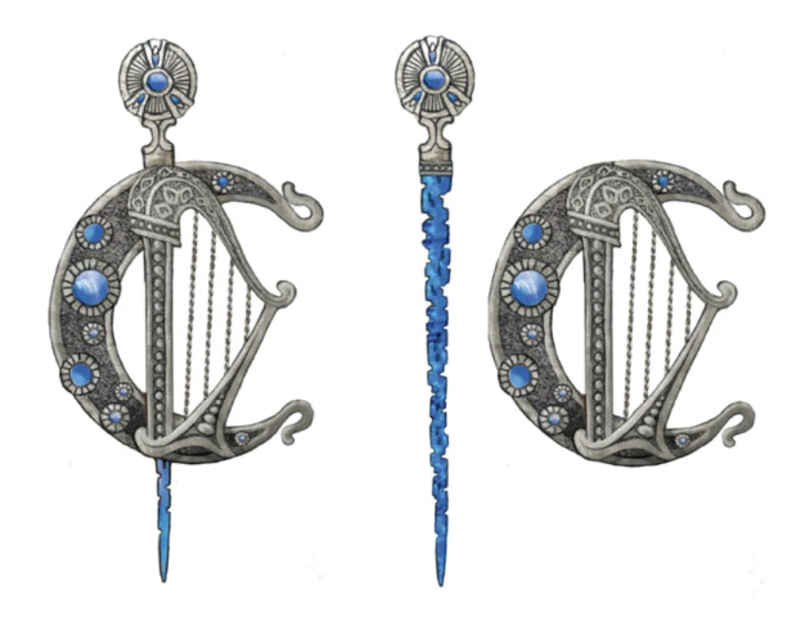
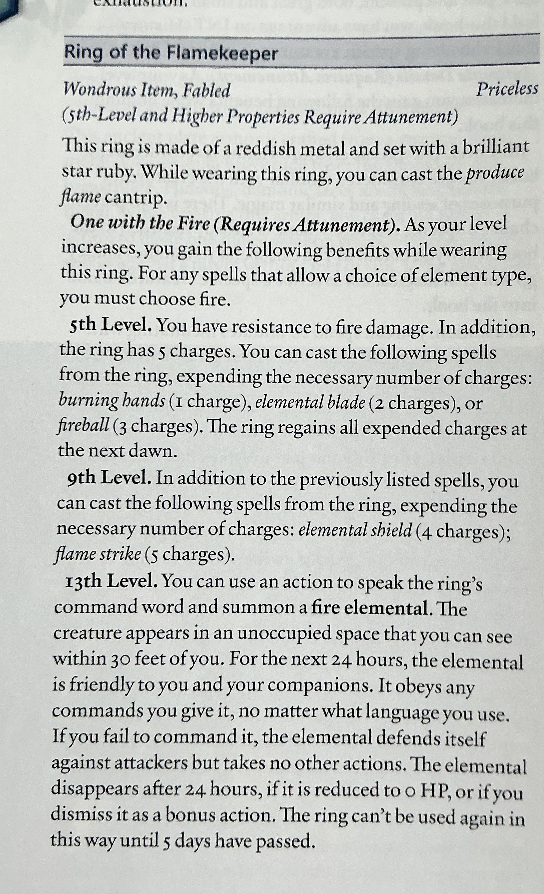

# Loot  
Cabin  
Dagger of Necromancy  
Sharn Kreed -> Harper Pin  
  
  
  
  
  
  
  
  
Letchountos crypt  
  
  
  
**Ring of the Flamekeeper**
*Wondrous Item, Fabled (5th-Level and Higher Properties Require Attunement)*
*Priceless*  
This ring is made of a reddish metal and set with a brilliant star ruby. While wearing this ring, you can cast the *produce flame* cantrip.  
***One with the Fire (Requires Attunement).*** As your level increases, you gain the following benefits while wearing this ring. For any spells that allow a choice of element type, you must choose fire.  
***5th Level.*** You have resistance to fire damage. In addition, the ring has 5 charges. You can cast the following spells from the ring, expending the necessary number of charges: *burning hands* (1 charge), *elemental blade* (2 charges), or *fireball* (3 charges). The ring regains all expended charges at the next dawn.  
***9th Level.*** In addition to the previously listed spells, you can cast the following spells from the ring, expending the necessary number of charges: *elemental shield* (4 charges); *flame strike* (5 charges).  
***13th Level.*** You can use an action to speak the ring's command word and summon a **fire elemental**. The creature appears in an unoccupied space that you can see within 30 feet of you. For the next 24 hours, the elemental is friendly to you and your companions. It obeys any commands you give it, no matter what language you use. If you fail to command it, the elemental defends itself against attackers but takes no other actions. The elemental disappears after 24 hours, if it is reduced to 0 HP, or if you dismiss it as a bonus action. The ring can't be used again in this way until 5 days have passed.  
  
Spell scrolls  
[https://5e.tools/book.html#XDMG,page:280](https://5e.tools/book.html#XDMG,page:280)  
  
[https://5e.tools/book.html#xdmg,6,conflict,0](https://5e.tools/book.html#xdmg,6,conflict,0)  
  
## Orb of Damara  
A wizard named Damara created this orb while devising a way to become a dragon. Aided by a mysterious magician (actually an aspect of Tiamat in disguise), Damara eventually created an Artifact that would enable him to achieve his dream. Yet the potential power of his creation terrified Damara so much that he dared not use the orb. Instead, the wizard entombed himself with the Artifact to seal it away.  
The *Orb of Damara* is about 6 inches in diameter and is made of a glassy, iridescent material that's like obsidian but incredibly hard. If held to one's own lips with the intention of consuming it, the orb shrinks to the size of a grape.  
  
***Properties of the Orb.*** While attuned to the orb, you gain the following benefits:  
* **Dragon's Breath.** You can take a [Magic](https://5e.tools/actions.html#magic_xphb) action to exhale a 15-foot [Cone](https://5e.tools/variantrules.html#cone%20%5barea%20of%20effect%5d_xphb). When you do, choose Acid, Cold, Fire, Lightning, or Poison. Each creature in the [Cone](https://5e.tools/variantrules.html#cone%20%5barea%20of%20effect%5d_xphb) makes a DC 18 Dexterity saving throw, taking 6d6 damage of the chosen type on a failed save or half as much damage on a successful one.  
* **Fear Aura.** You exude a terrifying aura in a 20-foot [Emanation](https://5e.tools/variantrules.html#emanation%20%5barea%20of%20effect%5d_xphb) while you don't have the [Incapacitated](https://5e.tools/conditionsdiseases.html#incapacitated_xphb) condition. You can take a [Magic](https://5e.tools/actions.html#magic_xphb) action to disable or enable this aura. Any enemy that starts its turn in the aura must succeed on a DC 18 Wisdom saving throw or have the [Frightened](https://5e.tools/conditionsdiseases.html#frightened_xphb) condition until the start of its next turn. A creature that succeeds on this save is immune to the aura's effects for 24 hours.  
  
## Armor of Versatile Resistance  
Armor (medium or heavy, but not hide), uncommon  
While wearing this armor, you gain a +1 bonus to AC  
and resistance to one damage type of your choice:  
bludgeoning, piercing, slashing, necrotic, force, or  
lightning. When you finish a short or long rest, you  
can choose a different damage type, replacing the  
previous choice.  
  
## Fruit of Foresight  
Wondrous item, uncommon  
You can eat this dried pear as an action. For the next 4  
hours you can’t be surprised, and if you roll 9 or lower  
on an initiative check, you can treat the roll as a 10  
instead.  
  
## Implosion Arrow  
Ammunition, uncommon  
When you hit with an attack using this arrow, it  
creates a sphere of gravity 15 feet in diameter centered  
on the target. Each creature other than the target  
within the sphere must make a DC 15 Dexterity  
saving throw. On a failed save, a creature is pulled 10  
feet toward the target, and it takes 3d6 bludgeoning  
damage and 1d6 force damage. The target and objects  
automatically fail this saving throw.  
  
## Tentacle Armband of Shielding  
Wondrous item, uncommon  
This silver band is carved in the shape of a tentacle and encircles your upper arm. While you wear this armband, you can cast the **shield** spell once per day. The shield takes the form of a translucent barrier of writhing tentacles. After you use this item, you can’t use it again until the next dawn.  
  
## Shield  
*Level 1 Abjuration*  
**Casting Time:** Reaction, which you take when you are hit by an attack roll or targeted by the Magic Missile spell  
**Components:** V, S  
**Range:** Self  
**Duration:** 1 round  
An imperceptible barrier of magical force protects you. Until the start of your next turn, you have a +5 bonus to AC, including against the triggering attack, and you take  
no damage from Magic Missile  
  
## Ring of Ancestral Healing  
Ring, uncommon (requires attunement)  
*A worn silver ring engraved with the d’Alphen family crest.*  
When you spend a Hit Die during a Short Rest, roll twice and take the higher result.  
“The dead do not let you fall so easily.”  
  
## Scroll of Fate  
you get a glimpse of the future. The DM must give you a truthfull answer about an event that wil happen in the future. Choose your wording carefully! (Self fulfilling prophecy)  
  
## Necklace of Adaptation  
*Wondrous Item, Uncommon (Requires Attunement) *1 lb.  
While wearing this necklace, you can breathe normally in any environment, and you have [Advantage](https://5e.tools/variantrules.html#advantage_xphb) on saving throws made to avoid or end the [Poisoned](https://5e.tools/conditionsdiseases.html#poisoned_xphb) condition.  
   

| Dark Shard Amulet
DMG'24
p248 |  |  |  |  |  |
| ---------------------------------------------------------------------------------------------------------------------------------------------------------------------------------------------------------------------------------------------------------------------------------------------------------------------------------------------------------------------------------------------------------------------------------------------------------------------------------------------------------------------------------------------------------------------------------------------------------------------------------------------------------------------------------------------- | - | - | - | - | - |
| Wondrous Item, Spellcasting Focus, Common (Requires Attunement By a Warlock) |  |  |  |  |  |
| 1 lb. |  |  |  |  |  |
| This amulet is fashioned from a shard of resilient material originating from an otherworldly realm. While you are wearing it, you gain the following benefits.
Spellcasting Focus. You can use the amulet as a Spellcasting Focus for your Warlock spells.
Unknown Spell. As a Magic action, you can try to cast a cantrip that you don't know. The cantrip must be on the Warlock spell list and have a casting time of an action, and you make a DC 10 Intelligence (Arcana) check. On a successful check, you cast the spell. On a failed check, the spell fails, and the action used to cast it is wasted. In either case, you can't use this property again until you finish a Long Rest. |  |  |  |  |  |
  
  

| Elemental Gem, Red Corundum
DMG'24
p257 |  |  |  |  |  |
| -------------------------------------------------------------------------------------------------------------------------------------------------------------------------------------------------------------------------------------------------------------------------------------------------------------------------------------------------------------------------------------------------------------------------------------------------------------------- | - | - | - | - | - |
| Wondrous Item, Uncommon |  |  |  |  |  |
|  |  |  |  |  |  |
| This gem contains a mote of elemental energy. When you take a Utilizeaction to break the gem, a Fire Elemental is summoned, and the gem ceases to be magical. The elemental appears in an unoccupied space as close to the broken gem as possible, understands your languages, obeys your commands, and takes its turn immediately after you on your Initiativecount. The elemental disappears after 1 hour, when it dies, or when you dismiss it as a Bonus Action. |  |  |  |  |  |
  
  
  
