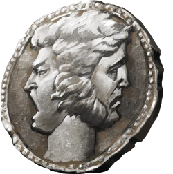

# Mark of the Doombringer  
  
  
  
1st-level necromancy (divine debt)  
Casting Time: Instantaneous (granted by Hoar)  
Duration: Until discharged or broken  
Range: Self  
Components: None (divine imposition)  
  
**Mark**. The mark appears on Klaus’s weapon hand, visible only to him and divine spellcasters of 3rd level or higher.   
While marked:  
	•	Klaus makes all death saving throws at disadvantage  
	•	Klaus cannot willingly move away from an ally who is targeted by an attack or harmful effect while he is within 10 feet  
  
**Discharging the Mark**. The mark is discharged when Klaus fulfills the following conditions:  
	•	He places himself between Gerda and a direct source of harm  
	•	He sustains damage as a result  
	•	The act must be voluntary and genuine — Hoar’s judgment is final  
  
On Discharge. Klaus may immediately cast Divine Smite as a free action. The smite deals an additional 1d6 Necrotic damage per point of Necrotic damage Gerda sustained from Klaus’s shove, in addition to the normal smite damage.  
  
Breaking the Mark. If Klaus deliberately avoids protecting Gerda when able to do so, the mark converts to an [Oathbreaker](https://forgottenrealms.fandom.com/wiki/Oathbreaker) warning at DM discretion.  
  
“Words are wind. Justice is paid in kind.” — Hoar  
