# NPC’s  
[Pathfinder NPC core archives of Nethys](https://2e.aonprd.com/Sources.aspx?ID=236)  
  
**Eryndor Mossveil** is a 327 year old male elf **druid**.  
Wanders as a brown bear in the vicinity of the ruins of the temple of Chauntea to protect the well of rebirth against invading blights. These have increased the last months (due to poking of the cult of chaos into the veils between the material plane and the chaos void)  
  
He has long, tangled silver hair laced with dried moss and leaves, and deep emerald eyes.  
He has weathered, bark-toned skin.  
He stands 178 cm (5’10”) tall and has a lean, wiry build.  
He has an angular, weathered face.  
  
He carries a shard of the abbey’s shattered altar on a cord around his neck, absently rubbing it whenever he grows troubled.  
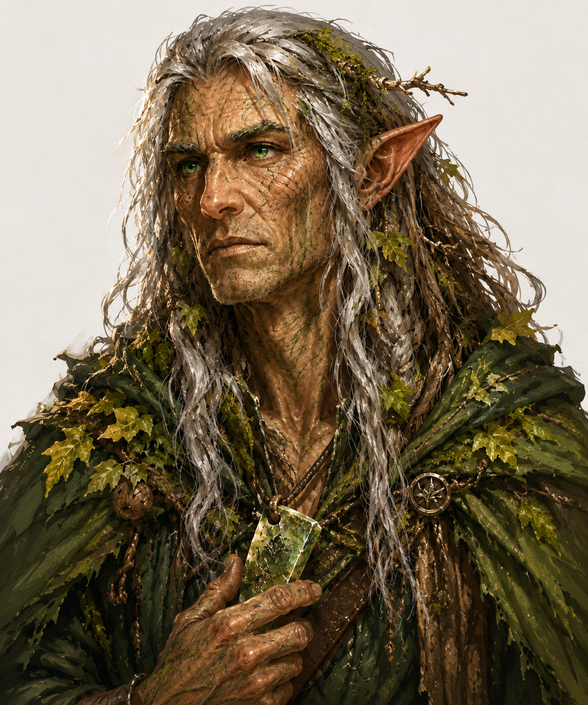  
Personality Traits  
He worships Chauntea, Goddess of agriculture and growth. (Neutral Good)  
He weighs every choice against the wellbeing of the forest before his own interests.  
He trusts the natural world over people, to a fault. He often falls silent mid-conversation to listen to distant birdsong or a shift in the wind.  
  
Ability Scores  
Strength - 12 (+1)	Dexterity - 14 (+2)	Constitution - 15 (+2)  
Intellect - 11 (+0)	Wisdom - 18 (+4)	Charisma - 10 (+0)  
  
Relationships  
Sexual Orientation - Straight  
Relationship Status - Solitary; lost a fellow acolyte he loved when the abbey fell, and has not sought companionship since.  
  
Alignment Tendencies  
Good: 7		Lawful: 3  
Neutral: 2	Neutral: 4  
Evil: 1		Chaotic: 3  
  
Plot Hook  
The recent surge in Blights near the ruins coincides with the same rift disturbances the Embers of Enlightenment’s mage has been tracking, and Eryndor’s records of corrupted growth may be the missing link tying Grimval’s curse to whatever still sleeps beneath the abbey’s crypt.  
  
—————————————————————————————-  
  
**Brennagh Voss** is a 41 year old female human merchant.   
She has shoulder-length, wavy, copper-red hair and amber eyes.   
She has tanned, weathered skin.   
She stands 168cm (5’6”) tall and has a sturdy build.   
She has a round, jovial face.  
She always wears a small silver scale around her neck.  
  
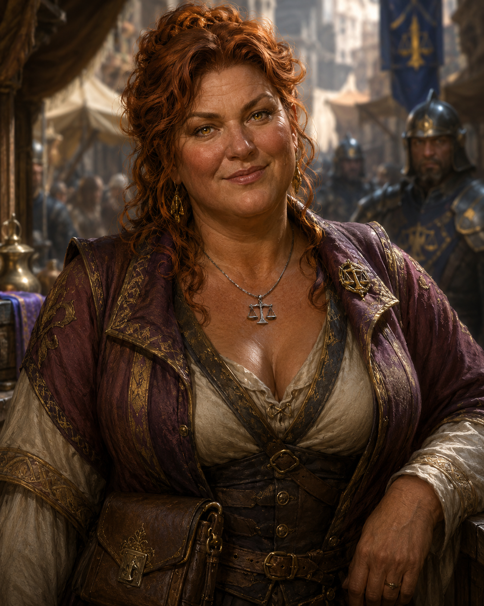  
Personality Traits   
She formally worships [Waukeen](https://forgottenrealms.fandom.com/wiki/Waukeen), Goddess of trade and wealth. (Neutral)   
She calculates profit before considering anything else.   
She is exceedingly generous toward regular customers.   
She negotiates over everything, even trivial matters.  
  
Ability Scores Strength - 11 [0] Dexterity - 13 [+1] Constitution - 14 [+2]   
Intellect - 15 [+2] Wisdom - 14 [+2] Charisma - 17 [+3]  
  
Relationships Sexual Orientation - Straight Relationship Status - Divorced  
Alignment Tendencies   
Good: 4 	Lawful: 5   
Neutral: 5 	Neutral: 4   
Evil: 1 		Chaotic: 1  
  
Plot Hook   
She unknowingly sells stolen goods through a middleman and is being watched by the city guard.   
————————————————————————   
  
**Othenard Pell** is a 58 year old male human apothecary. He has thin, gray, combed-back hair and watery blue eyes. He has pallid, papery skin. He stands 171cm (5’7”) tall and has a gaunt build. He has a narrow, lined face.  
He constantly smells of dried herbs and sulfur.  
  
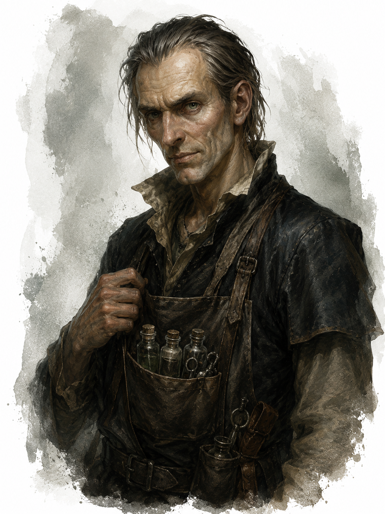  
  
Personality Traits   
He privately worships Talona, Goddess of poison and disease. (Chaotic Evil) He measures everything precisely before speaking. He is deeply secretive. He hoards rare ingredients rather than sells them.  
  
Ability Scores Strength - 8 [-1] Dexterity - 12 [+1] Constitution - 11 [0] Intellect - 18 [+4] Wisdom - 15 [+2] Charisma - 10 [0]  
  
Relationships Sexual Orientation - Asexual   
Relationship Status - Single  
Alignment Tendencies Good: 0 Lawful: 2 Neutral: 3 Neutral: 4 Evil: 7 Chaotic: 6  
  
Plot Hook He has been secretly poisoning a rival apothecary’s stock to drive him out of business.   
————————————————————————   
  
**Eldrin Aldermoss** is a 58 year old male human druid.  
He has long, matted, grey hair and pale green eyes.  
He has weathered, sun-browned skin.  
He stands 178 cm (5’10”) tall and has a lean build.  
He has a gaunt, hollow-cheeked face.  
  
He constantly mutters fragments of old liturgical chants under his breath, even mid-conversation.  
  
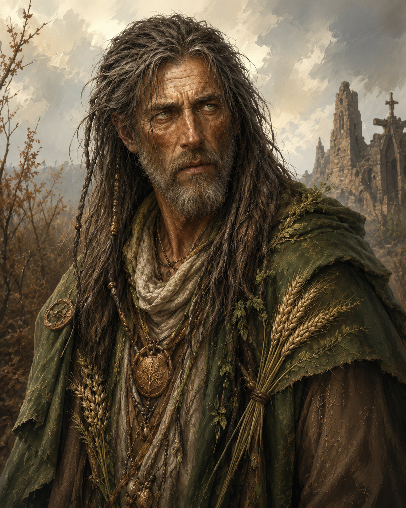  
  
Personality Traits  
He worships Chauntea, Goddess of agriculture and life. (Neutral Good)  
He weighs every decision against what will best preserve the land he once tended.  
He clings to ritual and routine to a fault, repeating the same daily devotions regardless of circumstance. He distrusts strangers who arrive too eager for answers.  
  
Ability Scores  
Strength - 10 (+0)	Dexterity - 13 (+1)	Constitution - 14 (+2)  
Intellect - 11 (+0)	Wisdom - 17 (+3)	Charisma - 9 (-1)  
  
Relationships  
Sexual Orientation - Straight  
Relationship Status - Widowed  
  
Alignment Tendencies  
Good: 6	Lawful: 3  
Neutral: 4	Neutral: 5  
Evil: 0		Chaotic: 2  
  
Plot Hook  
He carries the last surviving record of the abbey’s hidden vault, which he will only reveal to those who help him restore a single blighted field nearby.  
  
————————————————————————  
  
**Borin Stonefist** is a 142 year old male dwarf miner.  
He has short, coarse, iron-grey hair and dark brown eyes.  
He has rough, calloused skin.  
He stands 132 cm (4’4”) tall and has a stocky build.  
He has a broad, square-jawed face.  
  
He taps his pickaxe twice against any rock before deciding whether it’s worth striking.  
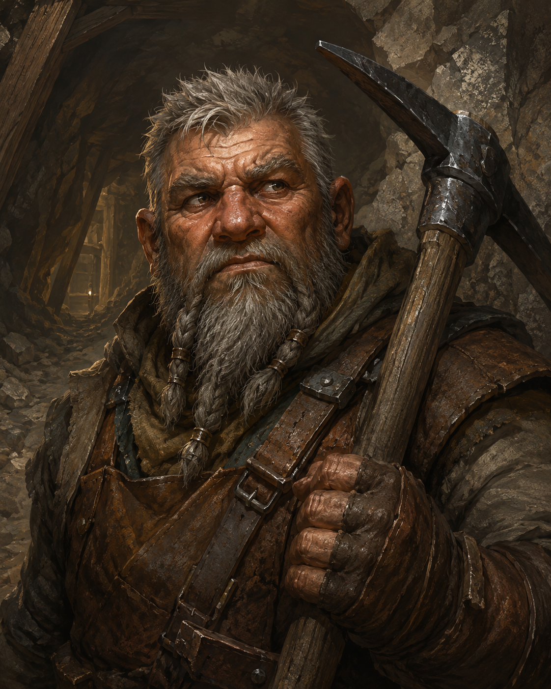  
  
Personality Traits  
He does not worship any deity.  
He trusts the weight and sound of stone over the words of strangers.  
He is stubborn to a fault, refusing to abandon a vein even when the tunnel grows unstable. He hums old mining songs when nervous.  
  
Ability Scores  
Strength - 16 (+3)	Dexterity - 11 (+0)	Constitution - 15 (+2)  
Intellect - 10 (+0)	Wisdom - 12 (+1)	Charisma - 8 (-1)  
  
Relationships  
Sexual Orientation - Straight  
Relationship Status - Married  
  
Alignment Tendencies  
Good: 4	Lawful: 6  
Neutral: 5	Neutral: 3  
Evil: 1		Chaotic: 1  
  
Plot Hook  
He recently uncovered a sealed passage that hums faintly with magic, and refuses to dig further without an escort he trusts.  
  
————————————————————————  
  
**Thessa Coalbeard** is a 97 year old female dwarf miner.  
She has braided, sooty, black hair and steel-grey eyes.  
She has cracked, grime-stained skin.  
She stands 124 cm (4’1”) tall and has a wiry build.  
She has a sharp, narrow face.  
  
She keeps a tally of every cave-in she’s survived, scratched into the haft of her hammer.  
  
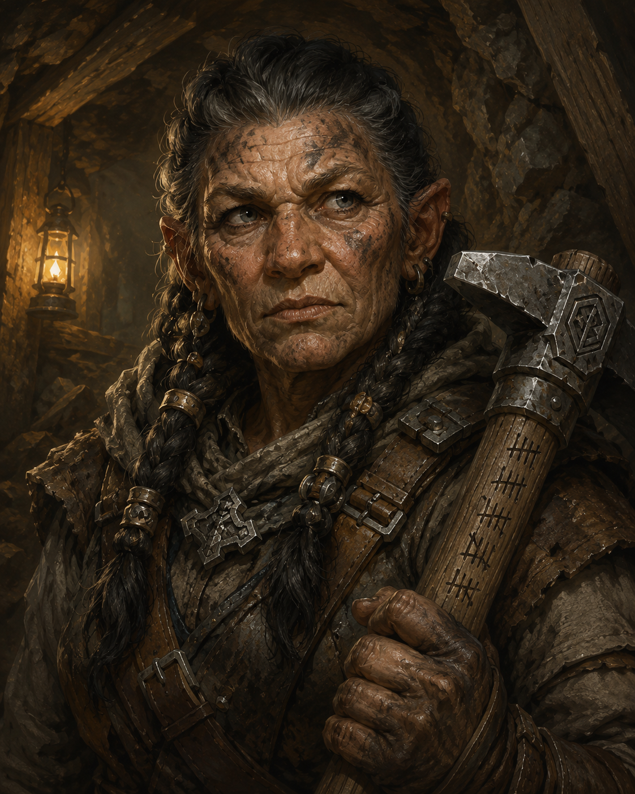  
  
Personality Traits  
She worships Moradin, God of creation and craft. (Lawful Good)  
She makes decisions quickly, trusting instinct over deliberation.  
She is fiercely loyal to a fault, following her crew into danger without hesitation. She refuses to eat before the youngest miner in her party has eaten first.  
  
Ability Scores  
Strength - 13 (+1)	Dexterity - 14 (+2)	Constitution - 13 (+1)  
Intellect - 12 (+1)	Wisdom - 10 (+0)	Charisma - 11 (+0)  
  
Relationships  
Sexual Orientation - Straight  
Relationship Status - Single  
  
Alignment Tendencies  
Good: 7	Lawful: 7  
Neutral: 2	Neutral: 2  
Evil: 1		Chaotic: 1  
  
Plot Hook  
She is searching for a missing apprentice who vanished in the same tunnels the player characters are investigating.  
  
————————————————————————  
  
**Gorrim Duskhollow** is a 211 year old male dwarf miner.  
He has long, grey-streaked, black beard-hair and one clouded grey eye and one amber eye.  
He has leathery, scarred skin.  
He stands 137 cm (4’6”) tall and has a thick build.  
He has a weathered, heavy-browed face.  
  
He lost his left eye to a cave collapse decades ago and now reads tunnel air currents by smell instead.  
  
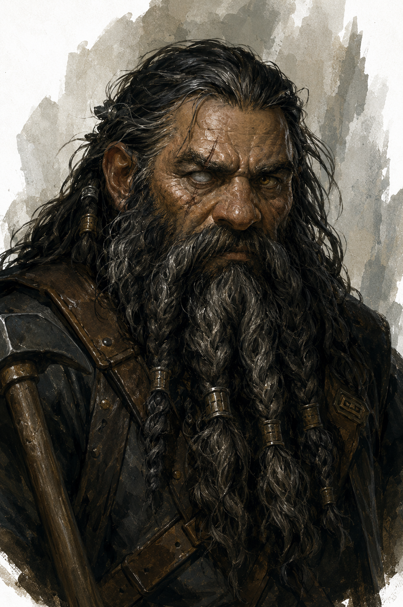  
  
Personality Traits  
He does not worship any deity.  
He deliberates carefully, distrusting any plan he hasn’t personally inspected.  
He is suspicious to a degree of anyone offering easy fortune underground. He never sleeps without his back to solid stone.  
  
Ability Scores  
Strength - 14 (+2)	Dexterity - 9 (-1)	Constitution - 16 (+3)  
Intellect - 13 (+1)	Wisdom - 14 (+2)	Charisma - 7 (-2)  
  
Relationships  
Sexual Orientation - Straight  
Relationship Status - Widowed  
  
Alignment Tendencies  
Good: 3	Lawful: 4  
Neutral: 6	Neutral: 4  
Evil: 1		Chaotic: 2  
  
Plot Hook  
He claims to know a route into the same collapsed mine where he lost his eye, but will only guide the party there in exchange for vengeance against whatever caused the collapse.  
——————————————  
  
### Gorrick Hardpelt is a 35 year old male human cleric.  
He has thinning, grey-streaked, brown hair and pale blue eyes.  
He has sallow, deeply lined skin.  
He stands 180 cm (5’11”) tall and has a stooped build.  
He has a sunken, prematurely aged face.  
  
A lingering curse in Grimval has drained years from his life force, leaving him looking nearly two decades older than he actually is.  
  
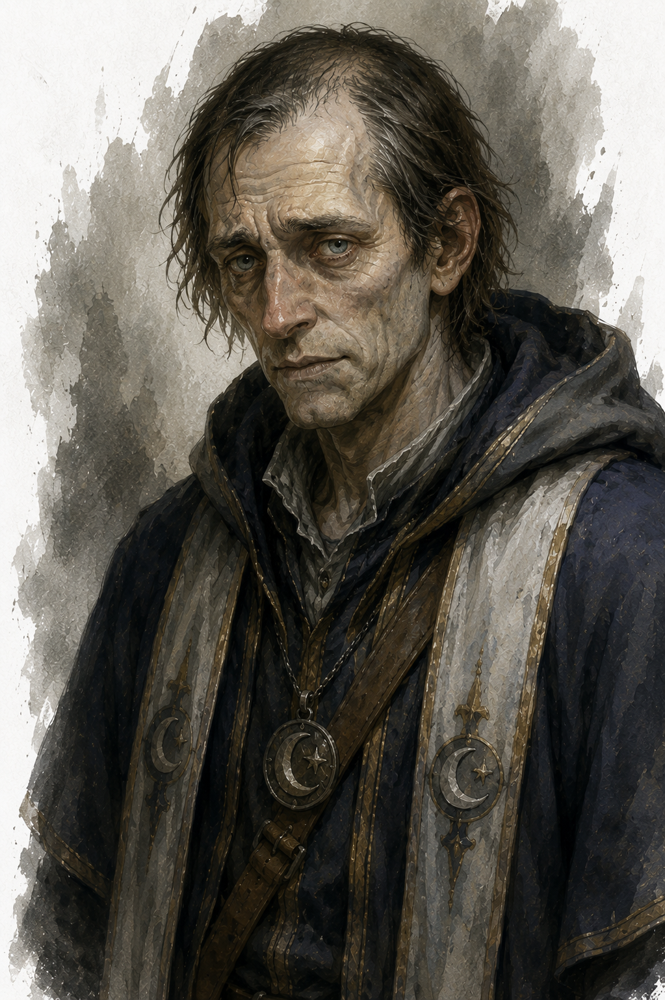  
  
Personality Traits  
He worships Selûne, Goddess of the moon. (Neutral Good)  
He deliberates slowly, weighing each decision against the temple’s teachings.  
He is dutiful to a fault, placing the temple’s obligations above his own failing health. He often pauses mid-sentence, momentarily winded, before continuing.  
  
Ability Scores  
Strength - 9 (-1)	Dexterity - 10 (+0)	Constitution - 11 (+0)  
Intellect - 12 (+1)	Wisdom - 16 (+3)	Charisma - 13 (+1)  
  
Relationships  
Sexual Orientation - Straight  
Relationship Status - Single  
  
Alignment Tendencies  
Good: 7		Lawful: 5  
Neutral: 2	Neutral: 4  
Evil: 1		Chaotic: 1  
  
Plot Hook  
He suspects Grimval’s curse is no accident and quietly hopes the player characters can uncover its source before it claims what remains of his vitality.  
  
————————————————————————  
  
### Meridith Wren is a 25 year old female human cleric.  
She has wavy, prematurely silvered, dark hair and silver-grey eyes.  
She has pale, papery, fine-lined skin.  
She stands 165 cm (5’5”) tall and has a slight build.  
She has a drawn, tired face.  
  
The same curse afflicting Grimval has aged her features by nearly twenty years, though her movements remain quick and youthful.  
  
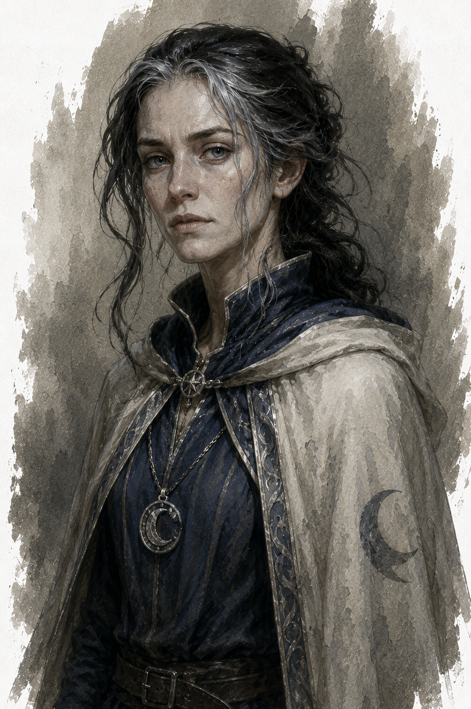  
  
Personality Traits  
She worships Selûne, Goddess of the moon. (Chaotic Good)  
She trusts her own judgment over doctrine, often acting before consulting Gorrick.  
She is independent to a fault, chafing against the temple’s slower, more cautious ways. She tends to wander Grimval at night, drawn restlessly toward the moonlight despite the curse’s toll.  
  
Ability Scores  
Strength - 10 (+0)	Dexterity - 13 (+1)	Constitution - 12 (+1)  
Intellect - 11 (+0)	Wisdom - 15 (+2)	Charisma - 14 (+2)  
  
Relationships  
Sexual Orientation - Straight  
Relationship Status - Single  
  
Alignment Tendencies  
Good: 6		Lawful: 1  
Neutral: 3	Neutral: 4  
Evil: 1		Chaotic: 5  
  
Plot Hook  
She has begun investigating the curse’s source against Gorrick’s wishes and may have found a lead she’s not yet ready to share with the temple.  
  
———————————————————————-  
  
**Aldous d’Alphen** is a 50 year old male human civic administrator.  
Replaced by a Doppelganger.  
He has ash-blond hair, thinning and oiled into a careful part, and pale blue eyes.  
He has weathered, well-tended skin, faintly sun-spotted from ceremonial appearances rather than labor.  
He stands 178 cm (5’10”) tall and has a stout, portly build.  
He has a square, jowled face.  
He taps his sister’s old signet ring against any hard surface when a conversation isn’t going his way, drawing eyes to the ring rather than to himself.  
  
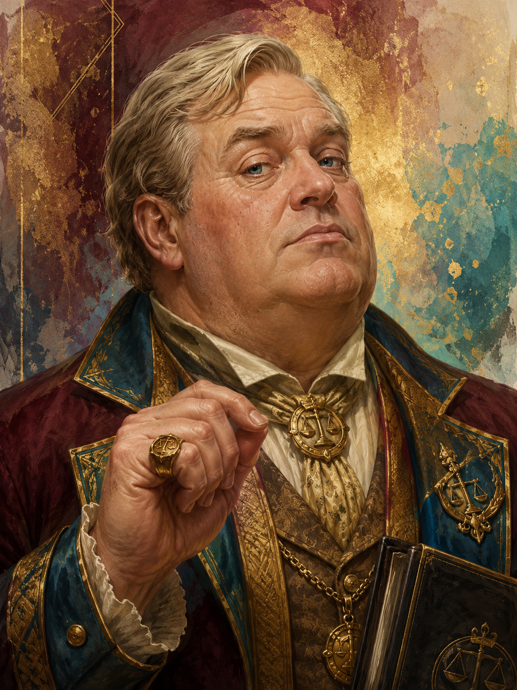  
Personality Traits  
He worships Waukeen, Goddess of Trade and Wealth. (Neutral)  
He weighs every decision by what it will visibly earn him rather than what it will accomplish.  
He craves recognition to a degree that he treats minor civic ceremonies as referendums on his worth. He keeps a private ledger of favors owed to him, updated after every conversation.  
  
Ability Scores  
Strength - 10 (+0)	Dexterity - 10 (+0)	Constitution - 12 (+1)  
Intellect - 13 (+1)	Wisdom - 10 (+0)	Charisma - 15 (+2)  
  
Relationships  
Sexual Orientation - Straight  
Relationship Status - Married; the marriage is more political ornament than partnership  
  
Alignment Tendencies  
Good: 2		Lawful: 4  
Neutral: 6	Neutral: 5  
Evil: 2		Chaotic: 1  
  
Plot Hook  
His sister, who secured him the post and still quietly directs it, is the one the party will actually need to negotiate with once Aldous proves more interested in credit than in solving their problem.  
———————————————————  
**Mort Kemnon** is a 134 year old male shadar-kai spy and enforcer.  
He has thin, ash-grey hair, cropped close to the scalp, and eyes the color of cold slate.  
He has charcoal-grey skin, taut and faintly cracked, like old stone left too long in the sun.  
He stands 178 cm (5’10”) tall and has a lean, sinewy build.  
  
He has a narrow, hollow-cheeked face.  
  
He never blinks at the same rate twice — a habit picked up from years of testing how long he can hold a stranger’s gaze before they look away first.  
  
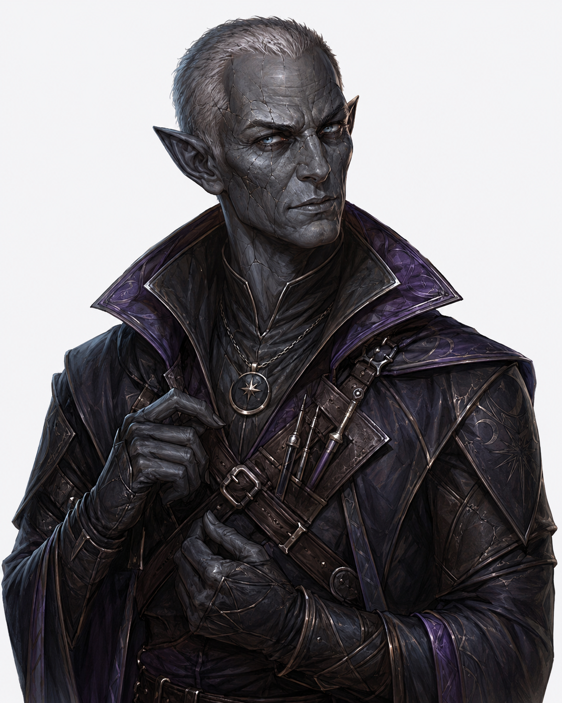  
Personality Traits  
He worships Shar, Goddess of Darkness and Loss. (Neutral Evil)  
He weighs every decision against what it costs him personally before considering anyone else’s stake in it.  
He treats secrecy as a virtue in itself, to a fault — he will withhold useful information from allies simply to retain leverage. He counts exits in any room he enters, even ones he has no intention of using.  
  
Ability Scores  
Strength - 11 (+0) Dexterity - 17 (+3) Constitution - 13 (+1)  
Intellect - 15 (+2) Wisdom - 14 (+2) Charisma - 12 (+1)  
  
Relationships  
Sexual Orientation - Straight  
Relationship Status - Single, deliberately unattached  
  
Alignment Tendencies  
Good: 1 Lawful: 3  
Neutral: 2 Neutral: 3  
Evil: 7 Chaotic: 4  
  
Plot Hook  
Mort has been dispatched by the Embers of Enlightenment to identify who in Ashford or Grimval is asking too many questions about the rifts, and the Hollow Latch’s recent activity has put him on the players’ trail before they’ve noticed him.  
