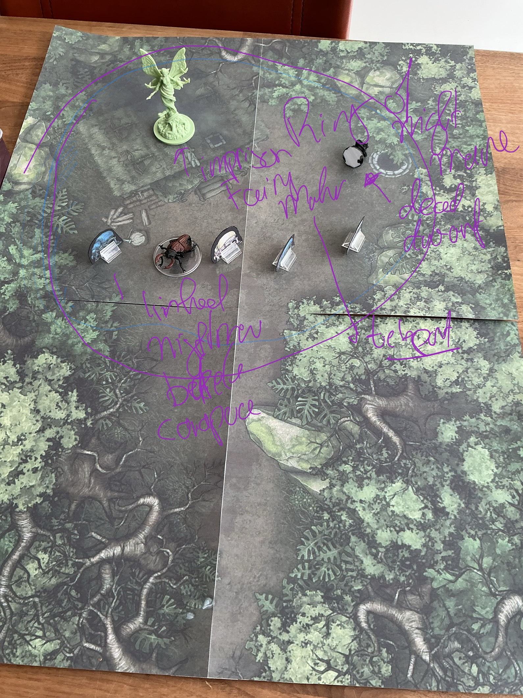

# Nighthag cabin Fey Matron  
  
  
Beetles sync met speler, ook met zijn turn. wis 18 frightened plus 1d6 psychic damage.  
  
Beetle Carapace Medium Undead (Skeleton), Neutral Evil  
Init. +3 | **AC 17** | HP 59 | Hits 6 | Speed 20, Fly 20 |  
STR +5 | DEX +3 | CON +4 | INT -5 | WIS +2 | CHA -2  
Skills: Acrobatics +6, Athletics +8  
Res: Cold 5, Lightning 5, Fire 5, Piercing 5, Slashing 5  
Imm: Bleed, Disease, Mental, Paralyzed, Poison, Unconscious; Death effects  
Senses: Darkvision, Passive Perception 12  
  
Abdomen Cache: Abdomen can store one Medium or smaller creature, a Large or smaller swarm, or equivalent cargo. Creature inside or the beetle can use an action to open the hatch. On a critical hit by a bludgeoning attack, DC 10 flat check or cache breaches and contents spill out. Can also be forced open with DC 15 Athletics check.  
  
Multiattack: One Mandible and one Foot attack.  
Mandible: Melee +8, 5 ft. 2d8+7 Piercing. On hit, target Grappled (escape DC 16).  
Foot: Melee +8, 5 ft. 2d6+7 Bludgeoning.  
Constrict: Grappled target takes 2d8+2 Piercing, DC 16 CON save for half.  
  
CR 5 (XP 1.800; PB +3)  
