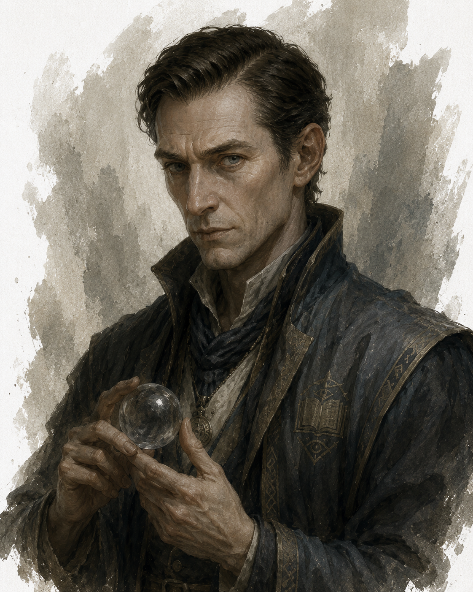
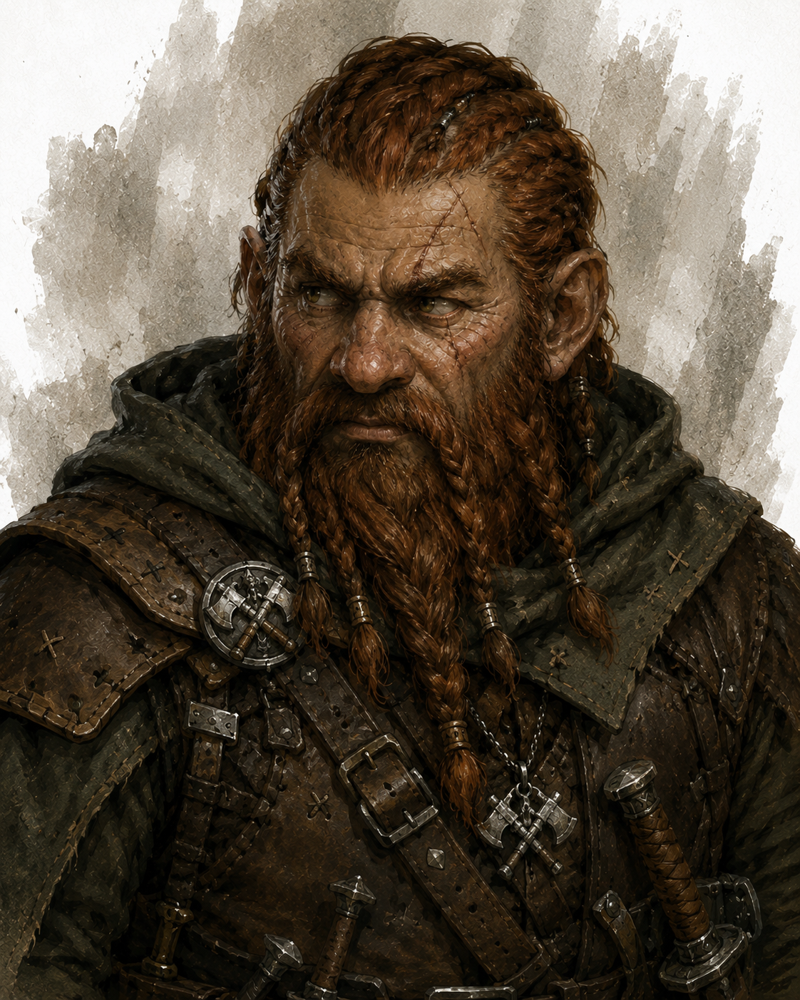

# Noristuor Gethin  
Noristuor is een researcher-mage die zich in de stad [Ashabenford](applenotes:note/89f819f4-ca61-4111-82bb-4a0f9b902c5f?ownerIdentifier=_b278a82f821370693820eb5509a1902d)  
gevestigd heeft om zijn magisch onderzoek voort te zetten, hij is de rifts op het spoor.  
Onopvallend gekleed, spreekt rustig, intelligente blik. Bezorgd. Fidget de hele tijd met een kleine kristallen bol.  
  
**Sharn Kreed** (dwarf) is zijn compagnion in de stad, een fighter/rogue. Missing in Action, week niets meer van gehoord, gezien. **Harper**  
  
Hij houdt zich op de achtergrond, omdat hij onderzoek doet namens een organisatie die chaos (Embers of Enlightenment), void, evil activiteiten in onderzoekt en probeert te begrijpen. Eledra heeft contact met hem gezocht, via een wederzijds contact. **Mateal Nerikas**. Motivatie is inzicht, leren, niet perse stoppen.  
—————-  
Noristuor Gethin is a 47 year old male human mage.  
He has short, neatly combed, dark brown hair and grey eyes.  
He has pale, indoor-pallored skin.  
He stands 175 cm (5’9”) tall and has a slender build.  
He has an angular, thoughtful face.  
  
He fidgets constantly with a small crystal orb, turning it over in his fingers even while speaking.  
  
  
  
Personality Traits  
He worships Oghma, God of knowledge. (Lawful Neutral)  
He weighs every action carefully against the risk of exposing his organization’s work.  
He is secretive to a fault, deflecting personal questions even with allies. He speaks in a calm, measured tone that rarely betrays the worry visible in his eyes.  
  
Ability Scores  
Strength - 8 (-1)	Dexterity - 11 (+0)	Constitution - 10 (+0)  
Intellect - 17 (+3)	Wisdom - 14 (+2)	Charisma - 12 (+1)  
  
Relationships  
Sexual Orientation - Straight  
Relationship Status - Single  
  
Alignment Tendencies  
Good: 5	Lawful: 6  
Neutral: 5	Neutral: 3  
Evil: 0		Chaotic: 1  
  
Plot Hook  
He is desperate to find his missing companion Sharn Kreed, whose disappearance he fears is tied to the same rift activity he has been secretly investigating for the Embers of Enlightenment.  
  
————————————————————————  
  
**Sharn Kreed** is a 134 year old male dwarf fighter/rogue.  
He has short, braided, russet hair and hazel eyes.  
He has scarred, weathered skin.  
He stands 130 cm (4’3”) tall and has a stocky build.  
He has a hard-edged, scarred face.  
  
He has a habit of disappearing mid-conversation, only to reappear moments later having scouted the surroundings.  
  
Personality Traits  
He worships [Clangeddin Silverbeard](https://forgottenrealms.fandom.com/wiki/Clangeddin_Silverbeard), God of war and combat. (Chaotic Good)  
He acts on instinct first, sorting out consequences afterward.  
He is reckless to a fault, charging into danger before a plan is fully formed. He keeps a running tally of debts owed to him, in coin or favors.  
  
Ability Scores  
Strength - 14 (+2)	Dexterity - 16 (+3)	Constitution - 13 (+1)  
Intellect - 10 (+0)	Wisdom - 9 (-1)	Charisma - 13 (+1)  
  
Relationships  
Sexual Orientation - Straight  
Relationship Status - Single  
  
Alignment Tendencies  
Good: 6	Lawful: 2  
Neutral: 3	Neutral: 3  
Evil: 1		Chaotic: 5  
  
Plot Hook  
He went missing while trailing a lead on rift activity outside Ashford, and the last person who saw him claims he ran toward, not away from, the disturbance.  
