# Riders of Mistledale  
**Alianor Commonbrook** is a 50 year old female human captain of the guard  
**Althalos Silverdraft **is a 26 year old male human fighter. (great to oppose Klaus)  
**Cedrian Hawkmoor **is a 34 year old male human ranger. **2nd in command**  
**Joseph Duststone **is a 23 year old male human soldier of the guard  
**Yseult Brennan** is a 29 year old female human paladin. **3rd in command **  
**Roswitha Aldmark** is a 37 year old female human soldier of the guard  
**Perrin Oakhollow** is a 41 year old male human soldier of the guard  
**Bram Fennimore** is a 27 year old male human soldier of the guard  
**Odalys Thorn** is a 35 year old female human soldier of the guard  
**Garrick Vane** is a 45 year old male human soldier of the guard  
***++Thrundil Ironvale++****++ is a 252 year old male dwarf soldier of the guard. ++*  
***++Faelaris Windrow++****++ is a 256 year old male elf ranger of the Mistledale Riders. ++*  
  
—————————————————————————————————————————————-  
**Althalos Silverdraft **is a 26 year old male human fighter.  
He has cropped, straight, gray hair and blue eyes.  
He has soft black skin.  
He stands 192cm (6'3") tall and has a muscular build.  
He has a sharp, bland face.  
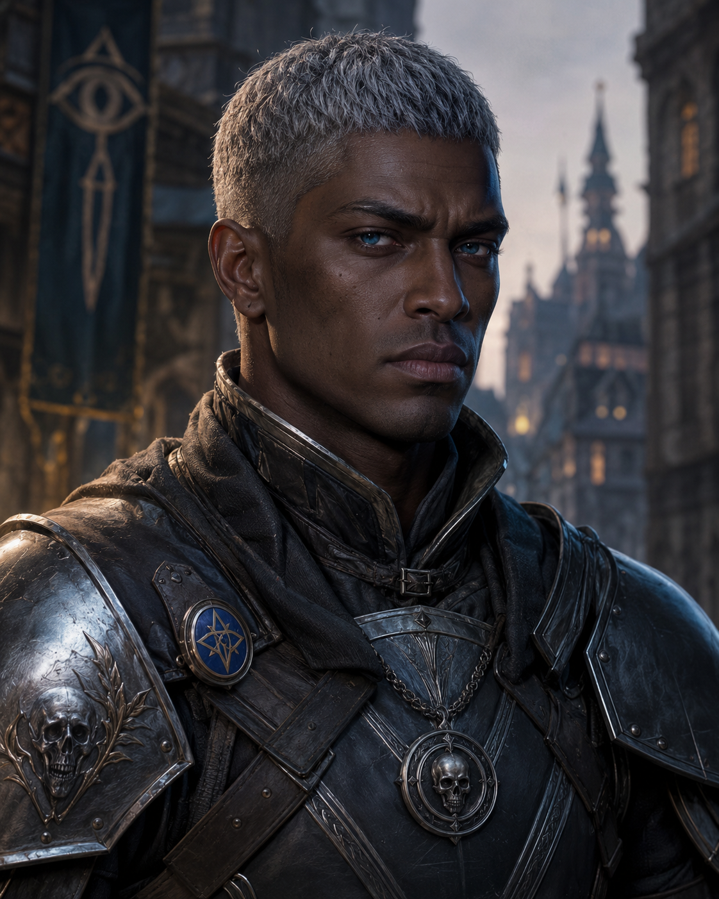  
He quietly worships [Kelemvor](https://forgottenrealms.fandom.com/wiki/Kelemvor), God of death and the dead. (Lawful Neutral)  
He is very cynical.   
He is a perfectionist. He argues about everything.  
  
Ability Scores  
Strength - 23 [+6]  
Dexterity - 9 [-1]  
Constitution - 21 [+5]  
Intellect - 7 [-2]  
Wisdom - 11 [0]  
Charisma - 14 [+2]  
  
Relationship Status - Single  
  
Alignment Tendencies  
Good: 6 Lawful: 2  
Neutral: 4 Neutral: 4  
Evil: 0 Chaotic: 0  
  
Plot Hook  
He is spying the players on behalf of the local wizards' guild.  
————————————————————————  
**Alianor Commonbrook** is a 50 year old female human captain of the guard  
She has short wild hair and green eyes.  
She has rugged golden skin.  
She stands 164cm tall and has a slender  build.  
She has a square, forgettable face.  
She smokes the pipe frequently.  
  
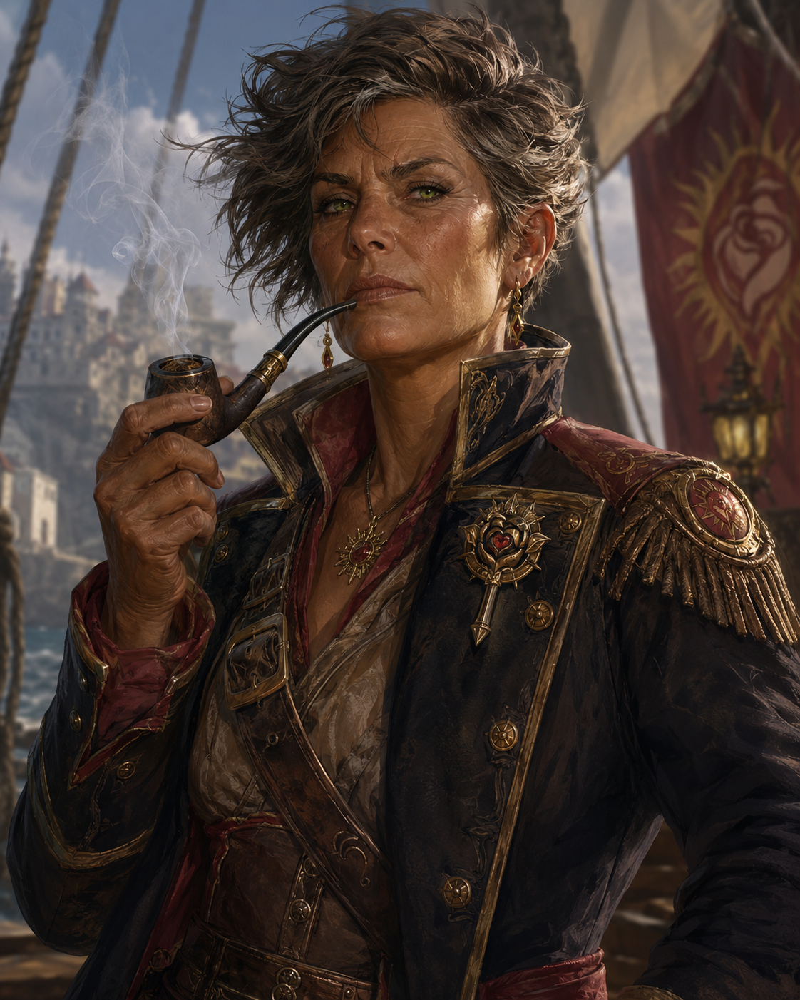  
Personality Traits  
She proudly worships [Sune](https://forgottenrealms.fandom.com/wiki/Sune), Goddess of beauty, love, passion. (Chaotic Good)  
She would rather act than talk or think.   
She is very obstinate. She always obeys her superiors. She reads every book she comes across.  
Even though her passion has led her astray, now involved with her lover that is slowly corrupting her.  
That lover is a cultist, he has a hidden agenda, he does nog truely love her. He she’s her as an instrument.  
The entry point of these cultists is always chaos. People with chaotic tendencies have a weak spot if not balanced. **Alianor **has become bored with her function, and could not reconcile with a still born child 30 years ago. She subconsciously blamed her husband for this, not being strong enough in seed. What she does not know it was because of lead poisoning, what is causing her innate lawfull nature to falter.  
  
Ability Scores  
Strength - 15 [+2] Dexterity - 9 [-1] Constitution - 14 [+2]  
Intellect - 11 [0] Wisdom - 12 [+1] Charisma - 12 [+1]  
  
Relationships  
Sexual Orientation - Straight, or whatever.  
Relationship Status - Married and having an affair  
  
Alignment Tendencies  
Good: 5 Lawful: 6  
Neutral: 5 Neutral: 4  
Evil: 0 Chaotic: 5  
  
Plot Hook  
She wants the PCs to help her tame a demon.   
  
————————————————————————  
  
**Joseph Duststone **is a 23 year old male human soldier of the guard  
He has very long, wavy, black hair and brown eyes.  
He has smooth tanned skin.  
He stands 162cm (5'3") tall and has an athletic build.  
He has a square, very pretty face.  
  
He is allergic to carrots.  
  
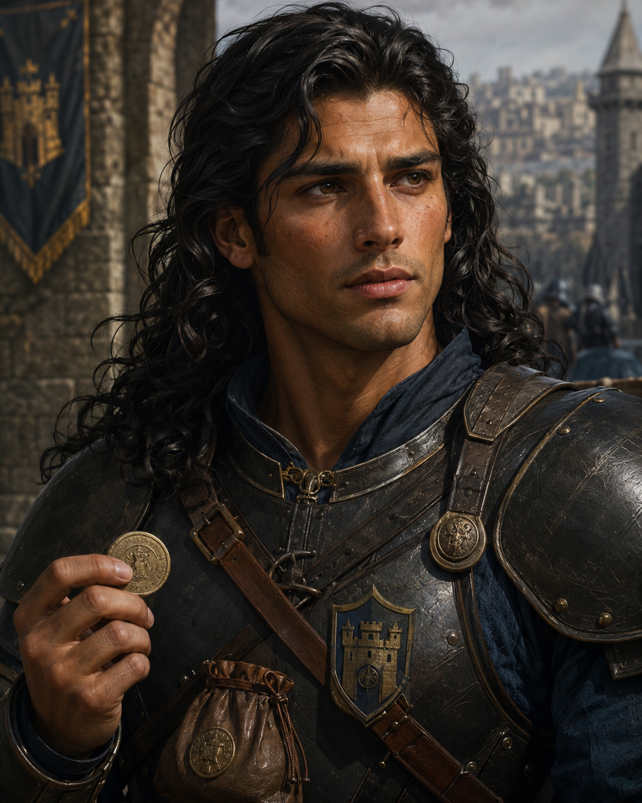  
Personality Traits  
He doesn't worship any god.  
He will ponder the pros and cons before making a decision.   
He is very courageous, to a fault. He intermittently quotes his father.  
  
Ability Scores  
Strength - 17 [+3]  
Dexterity - 12 [+1]  
Constitution - 17 [+3]  
Intellect - 9 [-1]  
Wisdom - 10 [0]  
Charisma - 13 [+1]  
  
Relationships  
Sexual Orientation - Straight  
Relationship Status - In a relationship  
  
Alignment Tendencies  
Good: 9 Lawful: 7  
Neutral: 4 Neutral: 4  
Evil: 0 Chaotic: 1  
  
Plot Hook  
He needs help finding a precious coin. (what?)  
————————————————————————  
  
**Cedrian Hawkmoor **is a 34 year old male human ranger. He has short, curly, chestnut-brown hair and gray eyes. He has weathered, light brown skin. He stands 188cm (6’2”) tall and has a lean build. He has an angular, thoughtful face.  
  
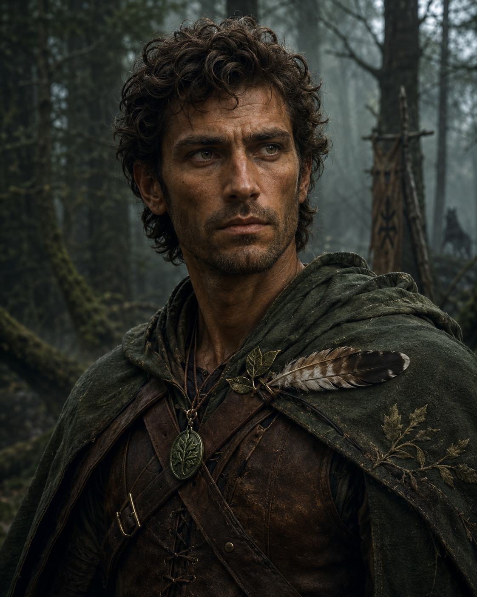  
  
He always carries a hawk’s feather with him.  
Personality Traits He quietly worships Mielikki, Goddess of the forest and nature. (Neutral Good) He observes thoroughly before acting. He is very distrustful of strangers. He unconsciously counts everything he sees.  
  
Ability Scores Strength - 16 [+3] Dexterity - 18 [+4] Constitution - 14 [+2] Intellect - 12 [+1] Wisdom - 16 [+3] Charisma - 9 [-1]  
  
Relationships Sexual Orientation - Straight Relationship Status - Widowed  
  
Alignment Tendencies Good: 7 Lawful: 3 Neutral: 3 Neutral: 5 Evil: 0 Chaotic: 2  
  
Plot Hook   
He is tracking a series of wolf killings that leads toward a cult. (The werewolves are opposing the cult)————————————————————————  
  
**Yseult Brennan** is a 29 year old female human paladin. She has long, straight, ash-blonde hair and hazel eyes. She has pale, freckled skin. She stands 178cm (5’10”) tall and has a muscular build. She has a broad, determined face.  
She wears a scar over her left eyebrow with pride.  
  
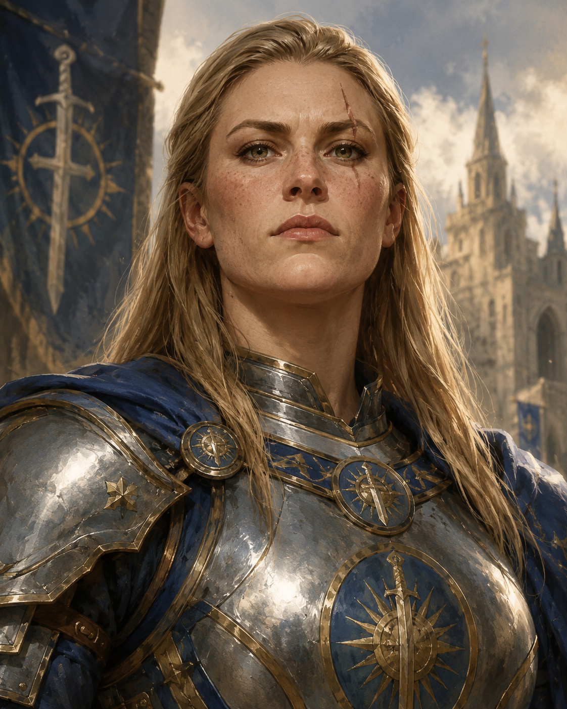  
  
Personality Traits She openly worships Torm, God of courage and self-sacrifice. (Lawful Good) She acts impulsively out of conviction, rarely out of calculation. She is unyielding in her principles. She always confronts dishonesty directly.  
  
Ability Scores Strength - 18 [+4] Dexterity - 11 [0] Constitution - 16 [+3] Intellect - 10 [0] Wisdom - 13 [+1] Charisma - 15 [+2]  
  
Relationships Sexual Orientation - Bisexual Relationship Status - Single  
Alignment Tendencies   
Good: 8 Lawful: 8   
Neutral: 2 Neutral: 2   
Evil: 0 Chaotic: 0  
  
Plot Hook   
Yseult’s growing suspicion of Ilvis Marrowen may lead her to investigate the Chauntea Temple circle in Ashford, putting her on a collision course with the Cult of Chaos cell.  
————————————————————————  
**Roswitha Aldmark** is a 37 year old female human soldier of the guard. She has long, braided ash-blonde hair and dark brown eyes. She has weathered, sun-browned skin. She stands 168 cm (5’6”) tall and has a stocky, muscular build. She has a broad, square-jawed face.  
She whittles small wooden tokens for the Ashford children whenever the Riders return from patrol.  
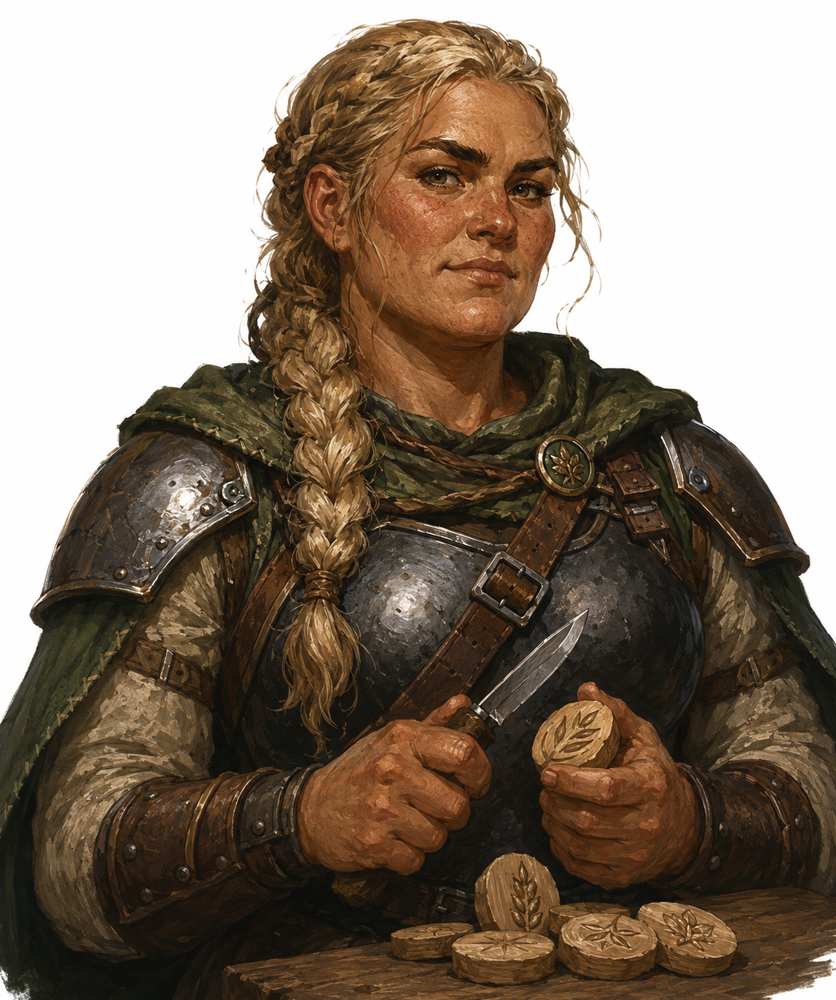  
  
Personality Traits She worships Chauntea, Goddess of Agriculture. (Neutral Good)   
She favors practical solutions over strict procedure, bending regulations when it serves the townsfolk.   
She is fiercely protective of Ashford’s farmers to a degree that clouds her judgement on matters of trade disputes. She hums old harvest songs under her breath while on watch.  
  
Ability Scores Strength - 15 (+2) Dexterity - 12 (+1) Constitution - 14 (+2) Intellect - 10 (+0) Wisdom - 13 (+1) Charisma - 11 (+0)  
  
Relationships Sexual Orientation - Straight Relationship Status - Married to a local miller  
Alignment Tendencies Good: 6 Lawful: 3 Neutral: 3 Neutral: 5 Evil: 1 Chaotic: 2  
  
Plot Hook   
Roswitha has noticed unusual absences among the farmers near the Temple ruins and asks the players to look into it, unaware the cause is tied to the Blight surge.  
————————————————————————  
**Perrin Oakhollow** is a 41 year old male human soldier of the guard.   
He has thinning, grey-streaked brown hair and hazel eyes. He has ruddy, weathered skin. He stands 173 cm (5’8”) tall and has a stout, heavyset build. He has a round, jowly face.  
He keeps meticulous ledgers of every supply requisition, correcting others aloud when their tallies are wrong.  
  
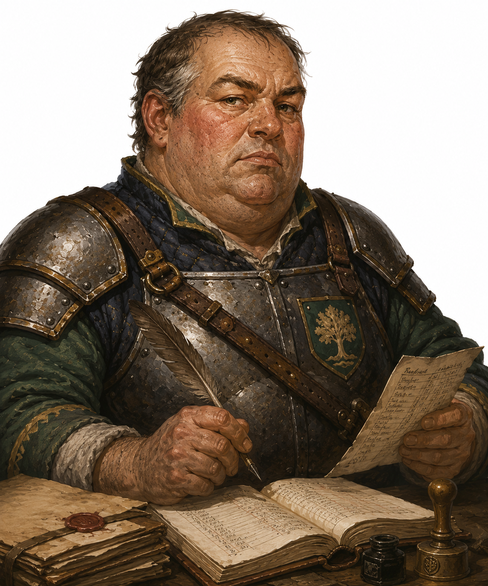  
  
Personality Traits He does not worship a deity. He favors procedure and paperwork over improvisation, insisting every decision be documented. He is stubbornly rule-bound to a fault, delaying urgent matters over incomplete forms. He complains constantly about budget cuts to the Riders’ equipment fund.  
  
Ability Scores Strength - 13 (+1) Dexterity - 10 (+0) Constitution - 14 (+2) Intellect - 14 (+2) Wisdom - 12 (+1) Charisma - 9 (-1)  
Relationships Sexual Orientation - Straight Relationship Status - Divorced  
  
Alignment Tendencies Good: 3 Lawful: 8 Neutral: 6 Neutral: 2 Evil: 1 Chaotic: 0  
  
Plot Hook   
Perrin’s ledgers reveal an unexplained diversion of Keep funds under Aldous d’Alphen’s authority, giving the players a paper trail to follow.  
————————————————————————  
————————————————————————  
**Bram Fennimore **is a 27 year old male human soldier of the guard.   
He has short, cropped sandy-blond hair and light blue eyes. He has tanned, calloused skin. He stands 182 cm (6’0”) tall and has a lean, athletic build. He has a sharp, angular face.  
He whistles old marching tunes while polishing his gear before every shift change.  
  
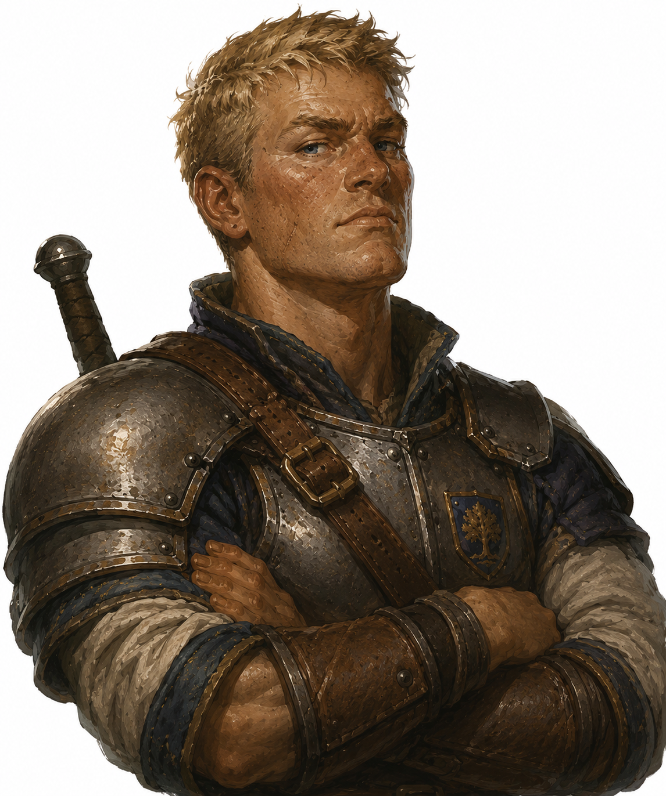  
  
  
Personality Traits He does not worship a deity.   
He favors quick, instinctive action over prolonged deliberation, often moving before orders are finished. He is recklessly eager to prove himself to a fault, volunteering for dangerous postings without weighing the risk. He keeps a running tally of duels he has won among the other Riders.  
  
Ability Scores Strength - 14 (+2) Dexterity - 15 (+2) Constitution - 13 (+1) Intellect - 10 (+0) Wisdom - 9 (-1) Charisma - 12 (+1)  
Relationships Sexual Orientation - Straight Relationship Status - Single  
  
Alignment Tendencies Good: 5 Lawful: 4 Neutral: 4 Neutral: 4 Evil: 1 Chaotic: 2  
  
Plot Hook   
Bram’s eagerness for glory leads him to volunteer for a night patrol near the Caves of Chaos, where he goes missing, giving the players a reason to investigate the caves.  
————————————————————————  
**Odalys Thorn** is a 35 year old female human soldier of the guard.   
She has cropped, dark brown hair and grey-green eyes.   
She has olive, weathered skin.   
She stands 170 cm (5’7”) tall and has a wiry, compact build. She has a lean, hollow-cheeked face.  
She sharpens her daggers in silence during briefings, never looking up from the blade.  
  
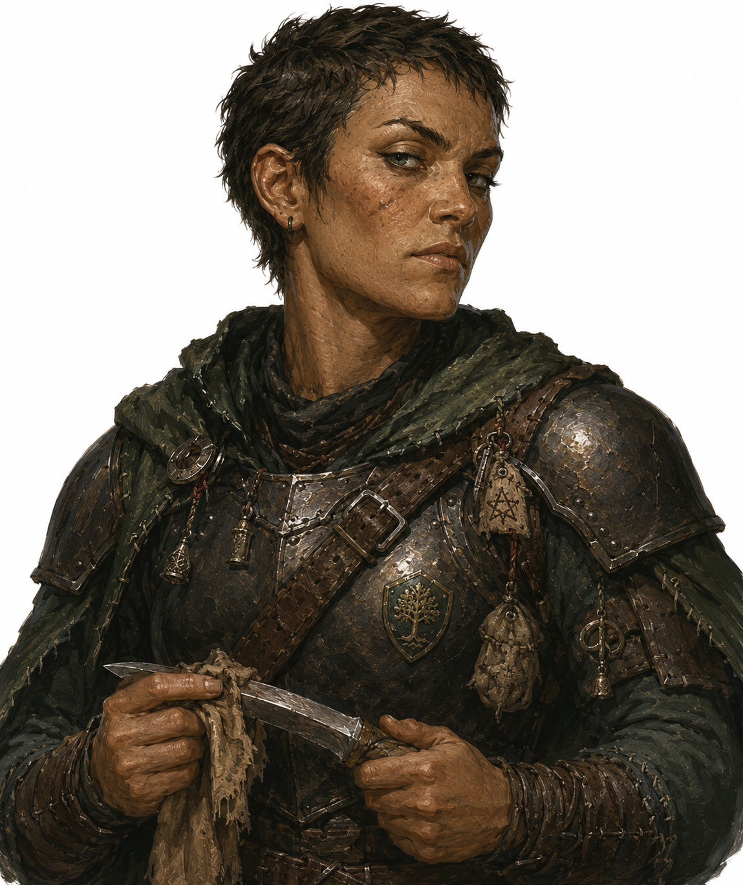  
Personality Traits   
She worships Beshaba, Goddess of Misfortune. (Chaotic Neutral)   
She favors cynical pragmatism over idealism, assuming the worst of most situations to avoid disappointment.   
She is deeply superstitious to a degree that affects her duty assignments, refusing certain patrol routes she considers cursed. She keeps small charms sewn into her uniform against bad luck.  
  
Ability Scores Strength - 12 (+1) Dexterity - 16 (+3) Constitution - 12 (+1) Intellect - 11 (+0) Wisdom - 14 (+2) Charisma - 10 (+0)  
  
Relationships   
Sexual Orientation - Straight   
Relationship Status - Single  
  
Alignment Tendencies   
Good: 2 Lawful: 2   
Neutral: 4 Neutral: 3   
Evil: 4 Chaotic: 5  
  
Plot Hook   
Odalys refuses to patrol the road near Grimvale, citing an old superstition, and her warnings turn out to have merit tied to the village’s life-draining curse.  
————————————————————————  
**Garrick Vane** is a 45 year old male human ***sergeant*** of the guard.   
He has greying, close-cropped black hair and dark brown eyes.   
He has weathered, scarred skin.   
He stands 176 cm (5’9”) tall and has a heavyset, powerful build. He has a blunt, scarred face.  
He counts his steps under his breath during long marches, a habit from his years as a caravan escort.  
  
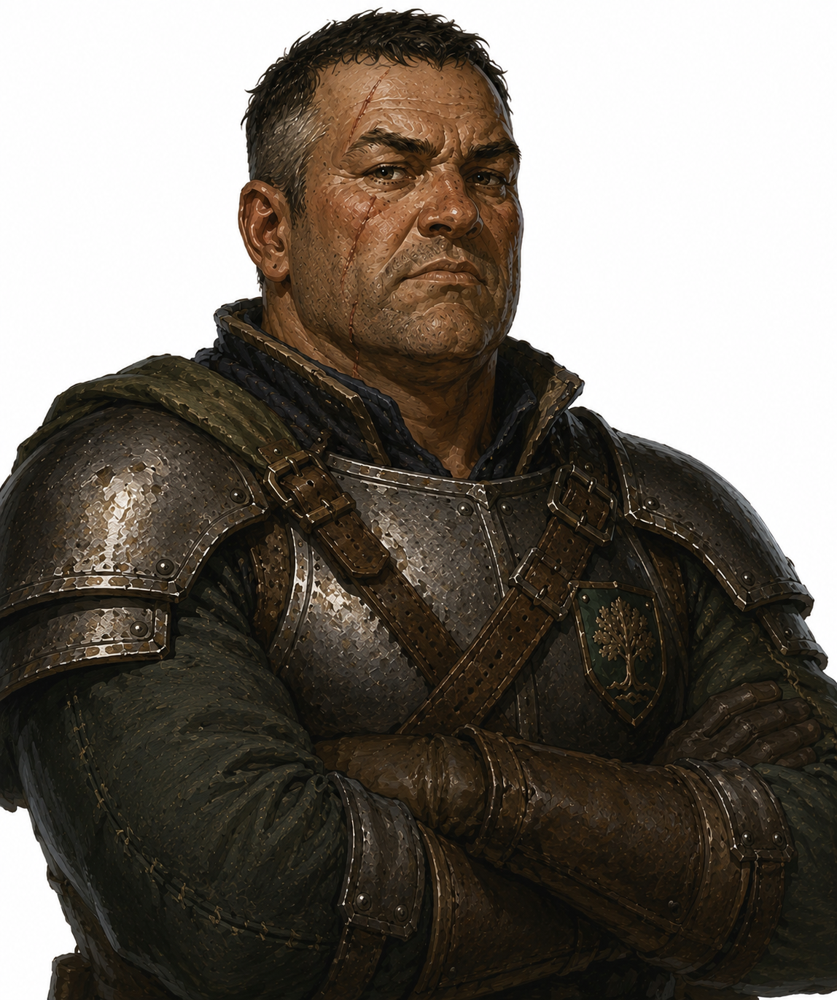  
  
Personality Traits   
He does not worship a deity. He favors caution and thorough scouting over speed, preferring to lose time rather than lives. He is deeply distrustful of authority to a degree that strains his relationship with Aldous d’Alphen, questioning orders he suspects serve personal interests rather than Ashford’s. He mentors the younger Riders informally, though never officially appointed to do so.  
  
Ability Scores Strength - 16 (+3) Dexterity - 11 (+0) Constitution - 15 (+2) Intellect - 12 (+1) Wisdom - 14 (+2) Charisma - 10 (+0)  
  
Relationships   
Sexual Orientation - Straight   
Relationship Status - Widowed, one adult child, **Ben**  
  
Alignment Tendencies   
Good: 5 Lawful: 3   
Neutral: 4 Neutral: 5   
Evil: 1 Chaotic: 2  
  
Plot Hook  
Garrick’s distrust of Aldous d’Alphen leads him to quietly gather evidence of the burgervader’s questionable orders, evidence he may share with the players if they earn his trust.  
————————————————————————  
**Thrundil Ironvale** is a 252 year old male dwarf soldier of the guard.   
He has a thick, braided iron-grey beard and dark brown eyes. He has ruddy, weathered skin. He stands 132 cm (4’4”) tall and has a stocky, powerfully built frame. He has a broad, heavily scarred face.  
He knocks twice on any wooden surface before sitting down, an old habit from his mining days.  
  
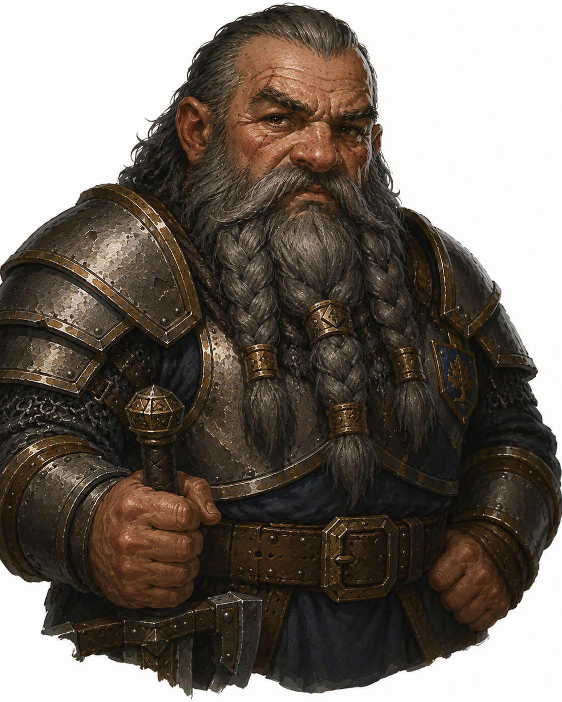  
  
  
Personality Traits   
He worships Clangeddin Silverbeard, God of War and Battle. (Lawful Good)   
He favors disciplined formation tactics over improvisation, drilling the same maneuvers until they become instinct.   
  
He is fiercely loyal to fellow Riders to a degree that borders on stubbornness, refusing to abandon a comrade even against direct orders. He grumbles constantly about the quality of human-forged steel.  
  
Ability Scores   
Strength - 16 (+3) Dexterity - 10 (+0)   
Constitution - 17 (+3) Intellect - 11 (+0)   
Wisdom - 13 (+1) Charisma - 9 (-1)  
  
axe:  +3, d6+3  
  
Relationships   
Sexual Orientation - Straight   
Relationship Status - Single  
  
Alignment Tendencies   
Good: 6 Lawful: 8   
Neutral: 4 Neutral: 2   
Evil: 0 Chaotic: 0  
  
Plot Hook Thrundil recognizes tool-marks near the Caves of Chaos as dwarven work, and suspects a connection to Sharn Kreed’s disappearance that he is eager to share with the players.  
————————————————————————  
  
**Faelaris Windrow **is a 256 year old male elf ranger of the Mistledale Riders.   
He has long, silver-white hair worn in a single braid and pale violet eyes.   
He has smooth, faintly luminous fair skin, unmarked by the passage of decades. He stands 178 cm (5’10”) tall and has a lean, willowy build.   
He has an angular, ageless face that could pass for a human in his late twenties.  
He pauses mid-sentence whenever birdsong changes nearby, tracking the shift before continuing his thought.  
  
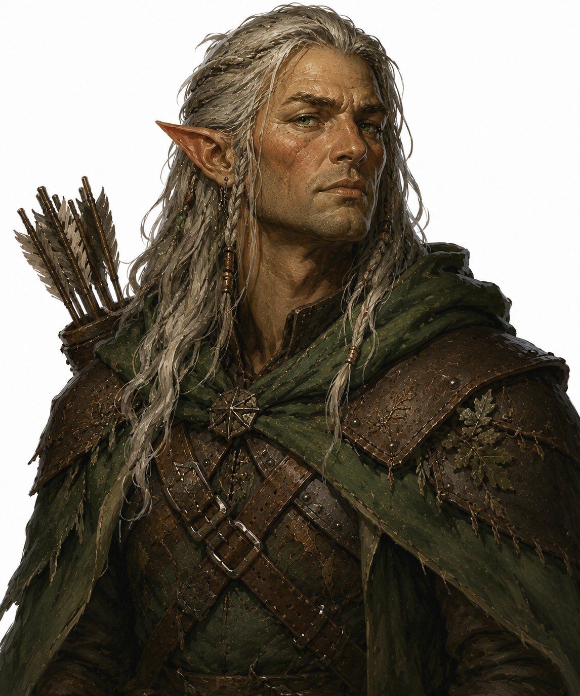  
  
Personality Traits   
He worships [Solonor Thelandira, ](https://forgottenrealms.fandom.com/wiki/Solonor_Thelandira)God of the Hunt. (Chaotic Good)   
He favors long-term observation over immediate action, content to track a threat for days before striking.   
He regards human urgency with quiet amusement to a degree that frustrates his fellow Riders, treating decade-old grudges and week-old crises with the same unhurried patience.   
He speaks of Ashford’s founding as though he remembers it personally, which unsettles those who realize he might.  
  
Ability Scores Strength - 11 (+0) Dexterity - 17 (+3) Constitution - 12 (+1) Intellect - 13 (+1) Wisdom - 15 (+2) Charisma - 12 (+1)  
  
Relationships   
Sexual Orientation - Straight   
Relationship Status - Single  
  
Alignment Tendencies   
Good: 7 Lawful: 2   
Neutral: 3 Neutral: 4  
Evil: 0 Chaotic: 4  
  
Plot Hook  
Faelaris has tracked faint traces of planar disturbance in the woods near the Temple of Chauntea for weeks, and his patient surveillance may connect Eryndor Mossveil’s Blight troubles to the wider rift activity.  
