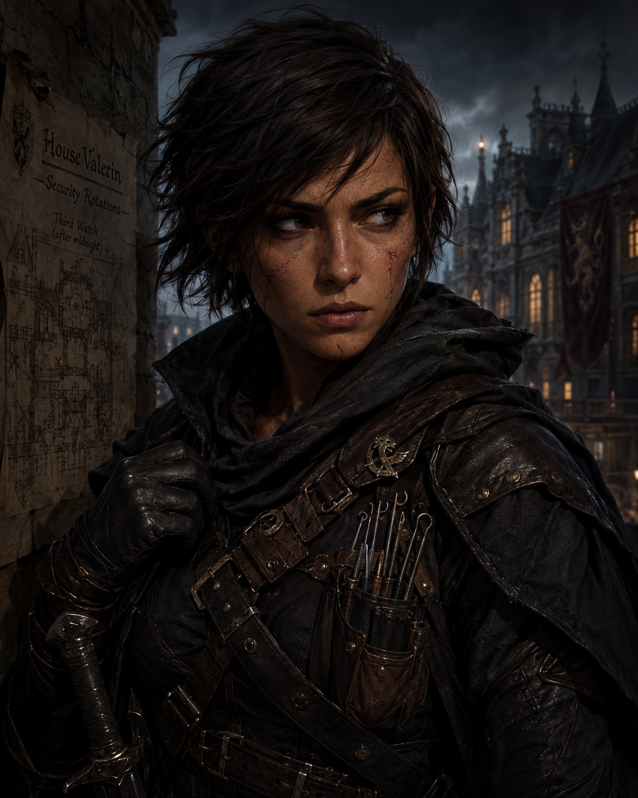
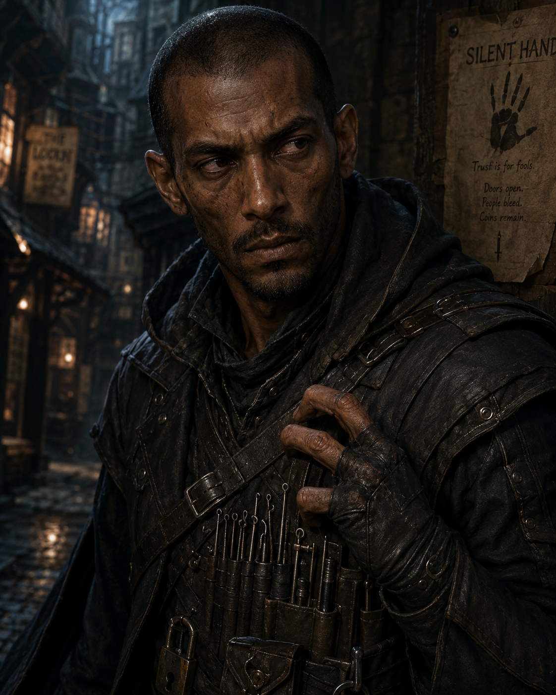
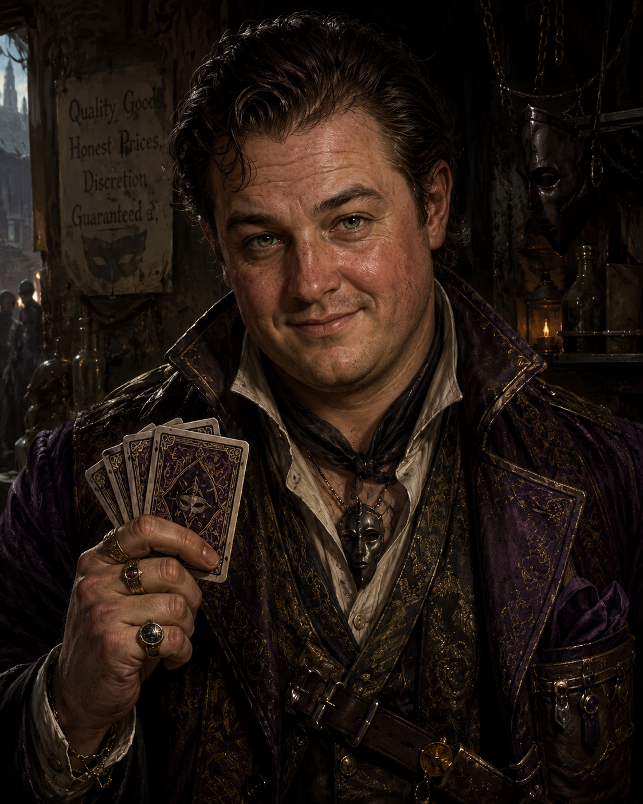
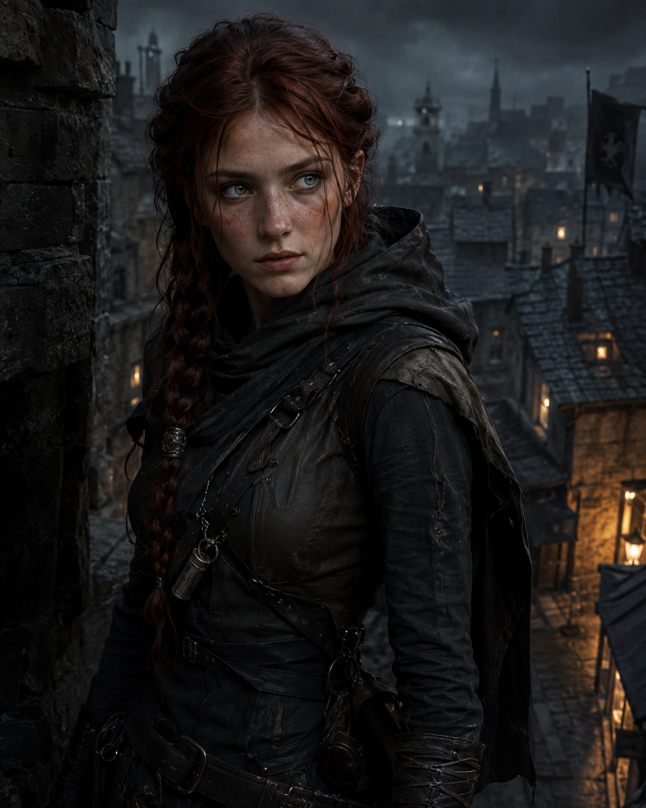
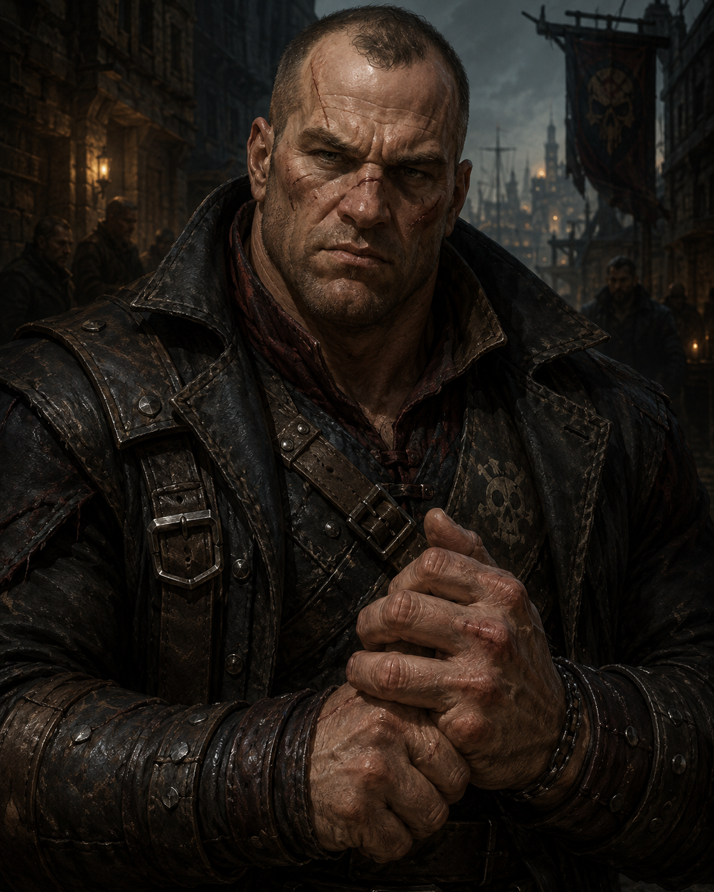
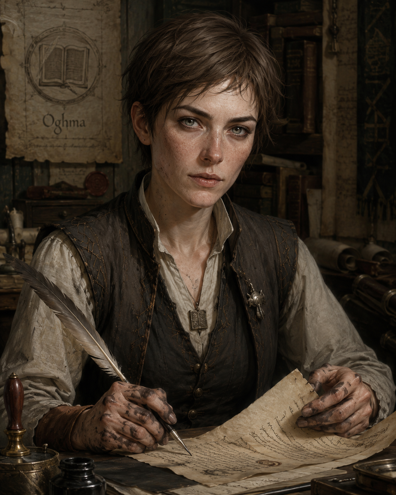
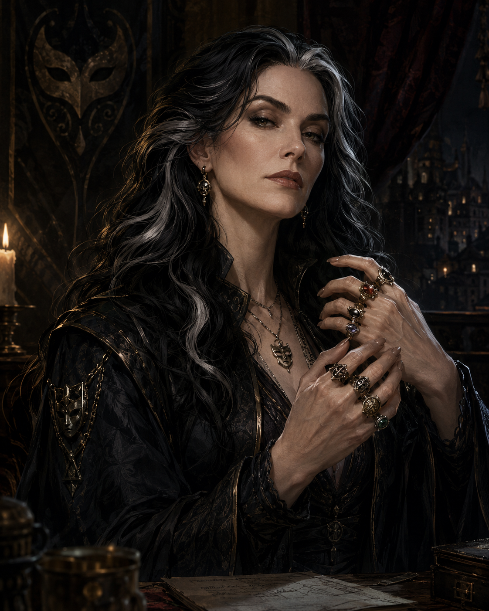
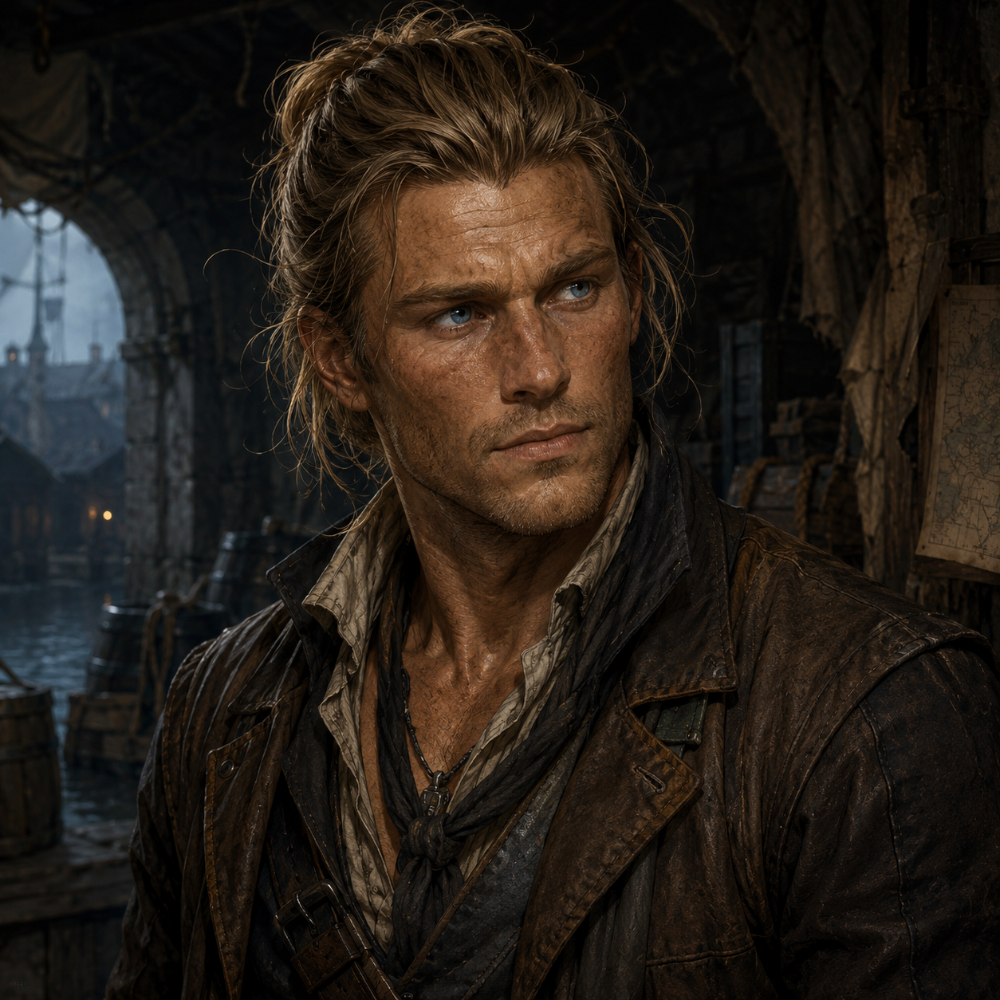

# The Hollow Latch  
Operating in and around Ashford, a market town grown prosperous on trade between the nearby Keep’s garrison and surrounding farmsteads, this eight-member crew runs theft, fencing, forgery, and smuggling through the gaps between the Keep’s military reach and the town watch’s thin patrols.  
  
————————————————————————  
  
**Ressa Quillane **is a 27 year old female human thief.  
She has short, choppy, dark brown hair and dark eyes.  
She has olive, scarred skin.  
She stands 160cm (5’3”) tall and has a wiry build.  
She has a sharp, alert face.  
  
She never removes her gloves in public.  
  
  
  
Personality Traits  
She worships Mask, God of Thieves and Shadows. (Chaotic Neutral)  
She makes decisions quickly and trusts her instincts over careful planning.  
She is fiercely independent to a fault, rarely asking for help even when it would serve her better. She counts exits in any room within seconds of entering.  
  
Ability Scores  
Strength - 9 (-1)	Dexterity - 17 (+3)	Constitution - 12 (+1)  
Intellect - 13 (+1)	Wisdom - 14 (+2)	Charisma - 11 (0)  
  
Relationships  
Sexual Orientation - Straight  
Relationship Status - Single  
  
Alignment Tendencies  
Good: 2		Lawful: 1  
Neutral: 5	Neutral: 3  
Evil: 3		Chaotic: 6  
  
Plot Hook  
Ressa recognizes one of the player characters from a job gone wrong years ago and is unsure whether to warn the crew or use the connection to her advantage.  
  
————————————————————————  
  
**Brask Iverlyn** is a 35 year old male human lockpick.  
He has shaved, stubbled, black hair and dark brown eyes.  
He has dark, calloused skin.  
He stands 180cm (5’11”) tall and has a lanky build.  
He has a long, narrow face.  
  
He has a missing left ring finger.  
  
  
  
Personality Traits  
He does not worship any deity.  
He weighs risk methodically before committing to any job.  
He is meticulous to a fault, often delaying jobs to perfect tools that are already good enough. He hums while working on a lock.  
  
Ability Scores  
Strength - 10 (0)	Dexterity - 18 (+4)	Constitution - 11 (0)  
Intellect - 14 (+2)	Wisdom - 12 (+1)	Charisma - 9 (-1)  
  
Relationships  
Sexual Orientation - Straight  
Relationship Status - Widowed  
  
Alignment Tendencies  
Good: 3		Lawful: 2  
Neutral: 6	Neutral: 5  
Evil: 1		Chaotic: 3  
  
Plot Hook  
Brask owes a debt to a locksmith in Ashford that the player characters could leverage to turn him into an informant.  
  
————————————————————————  
  
**Corwin Adley** is a 31 year old male human fence.  
He has slicked, oiled, brown hair and green eyes.  
He has freckled, ruddy skin.  
He stands 175cm (5’9”) tall and has a soft build.  
He has a round, amiable face.  
  
He always carries a deck of marked cards.  
  
  
  
Personality Traits  
He worships Waukeen, Goddess of Trade. (Neutral)  
He negotiates every angle before settling on a price.  
He is greedy to a degree that occasionally costs him repeat business. He always lowballs his first offer out of habit.  
  
Ability Scores  
Strength - 8 (-1)	Dexterity - 12 (+1)	Constitution - 13 (+1)  
Intellect - 15 (+2)	Wisdom - 11 (0)	Charisma - 17 (+3)  
  
Relationships  
Sexual Orientation - Straight  
Relationship Status - Married, secretly involved with a fellow crew member  
  
Alignment Tendencies  
Good: 2		Lawful: 4  
Neutral: 6	Neutral: 5  
Evil: 2		Chaotic: 1  
  
Plot Hook  
Corwin has fenced a stolen item that the player characters are searching for, and still has the buyer’s name on record.  
  
————————————————————————  
  
**Tamsin Orrow **is a 22 year old female human lookout.  
She has long, braided, dark red hair and gray-blue eyes.  
She has pale, freckled skin.  
She stands 158cm (5’2”) tall and has a slight build.  
She has a youthful, sharp face.  
  
She whistles old tavern tunes when nervous.  
  
  
Personality Traits  
She worships Tymora, Goddess of Luck. (Chaotic Good)  
She reacts on gut feeling and moves before overthinking a threat.  
She is loyal to a fault, sticking by crewmates even when it endangers her. She memorizes faces in a crowd without realizing she’s doing it.  
  
Ability Scores  
Strength - 9 (-1)	Dexterity - 16 (+3)	Constitution - 11 (0)  
Intellect - 12 (+1)	Wisdom - 15 (+2)	Charisma - 10 (0)  
  
Relationships  
Sexual Orientation - Bisexual  
Relationship Status - Single  
  
Alignment Tendencies  
Good: 6		Lawful: 1  
Neutral: 3	Neutral: 3  
Evil: 1		Chaotic: 6  
  
Plot Hook  
Tamsin overheard the Keep’s garrison discussing a patrol route the crew plans to exploit, information the player characters could intercept.  
  
————————————————————————  
  
**Garrick Holt** is a 39 year old male human enforcer.  
He has cropped, balding, brown hair and brown eyes.  
He has thick, scarred skin.  
He stands 191cm (6’3”) tall and has a heavy, muscular build.  
He has a flat, broken-nosed face.  
  
He cracks his knuckles before every confrontation.  
  
  
  
Personality Traits  
He does not worship any deity.  
He favors direct confrontation over negotiation.  
He is intimidating to a degree that unsettles even his own crew. He stands unnaturally still when listening.  
  
Ability Scores  
Strength - 18 (+4)	Dexterity - 11 (0)	Constitution - 16 (+3)  
Intellect - 9 (-1)	Wisdom - 10 (0)	Charisma - 8 (-1)  
  
Relationships  
Sexual Orientation - Straight  
Relationship Status - Divorced  
  
Alignment Tendencies  
Good: 1		Lawful: 3  
Neutral: 4	Neutral: 4  
Evil: 5		Chaotic: 3  
  
Plot Hook  
Garrick was once hired muscle for a noble the player characters are now investigating.  
  
————————————————————————  
  
Ivy Marlow is a 24 year old female human forger.  
She has neat, short, mousy brown hair and pale gray eyes.  
She has freckled, ink-stained skin.  
She stands 163cm (5’4”) tall and has a slim build.  
She has a plain, unremarkable face.  
  
She always has ink stains on her fingertips.  
  
  
  
Personality Traits  
She worships Oghma, God of Knowledge. (Neutral)  
She plans every detail in advance and rarely improvises.  
She is perfectionistic to a fault, redoing work others would consider finished. She mutters letterforms under her breath while forging a signature.  
  
Ability Scores  
Strength - 8 (-1)	Dexterity - 13 (+1)	Constitution - 10 (0)  
Intellect - 17 (+3)	Wisdom - 13 (+1)	Charisma - 12 (+1)  
  
Relationships  
Sexual Orientation - Straight  
Relationship Status - Single, secretly involved with a fellow crew member  
  
Alignment Tendencies  
Good: 3		Lawful: 6  
Neutral: 6	Neutral: 3  
Evil: 1		Chaotic: 1  
  
Plot Hook  
Ivy forged the deed the player characters are trying to prove fraudulent.  
  
————————————————————————  
  
Selene Marrow is a 44 year old female human crime lord.  
She has long, silver-streaked, black hair and hazel eyes.  
She has smooth, pale skin.  
She stands 170cm (5’7”) tall and has an elegant build.  
She has an angular, calculating face.  
  
She wears a different ring on each finger, each a trophy from a past mark.  
  
  
  
Personality Traits  
She worships Mask, God of Thieves and Shadows. (Neutral Evil)  
She delegates risk to others while keeping final decisions to herself.  
She is controlling to a degree that breeds quiet resentment among her crew. She rearranges her rings whenever she is calculating a lie.  
  
Ability Scores  
Strength - 9 (-1)	Dexterity - 13 (+1)	Constitution - 12 (+1)  
Intellect - 16 (+3)	Wisdom - 15 (+2)	Charisma - 18 (+4)  
  
Relationships  
Sexual Orientation - Lesbian  
Relationship Status - Widowed  
  
Alignment Tendencies  
Good: 1		Lawful: 3  
Neutral: 3	Neutral: 4  
Evil: 6		Chaotic: 3  
  
Plot Hook  
Selene has quietly marked one of the player characters as a future recruit, having watched them outmaneuver her crew once already.  
  
————————————————————————  
  
Dorian Thistlewood is a 29 year old male human smuggler.  
He has tied-back, sandy blond hair and blue eyes.  
He has weathered, tanned skin.  
He stands 178cm (5’10”) tall and has a rangy build.  
He has a weathered, square face.  
  
He sniffs the air before entering any unfamiliar room.  
  
  
  
Personality Traits  
He does not worship any deity.  
He adapts plans on the fly and prefers improvisation to rigid schemes.  
He is reckless to a degree that has nearly gotten him caught more than once. He checks every door twice before committing to a route.  
  
Ability Scores  
Strength - 12 (+1)	Dexterity - 15 (+2)	Constitution - 13 (+1)  
Intellect - 11 (0)	Wisdom - 12 (+1)	Charisma - 13 (+1)  
  
Relationships  
Sexual Orientation - Straight  
Relationship Status - Single  
  
Alignment Tendencies  
Good: 3		Lawful: 2  
Neutral: 5	Neutral: 4  
Evil: 2		Chaotic: 4  
  
Plot Hook  
Dorian smuggles goods past the Keep’s checkpoint using a route the player characters discover while investigating a string of disappearances.  
